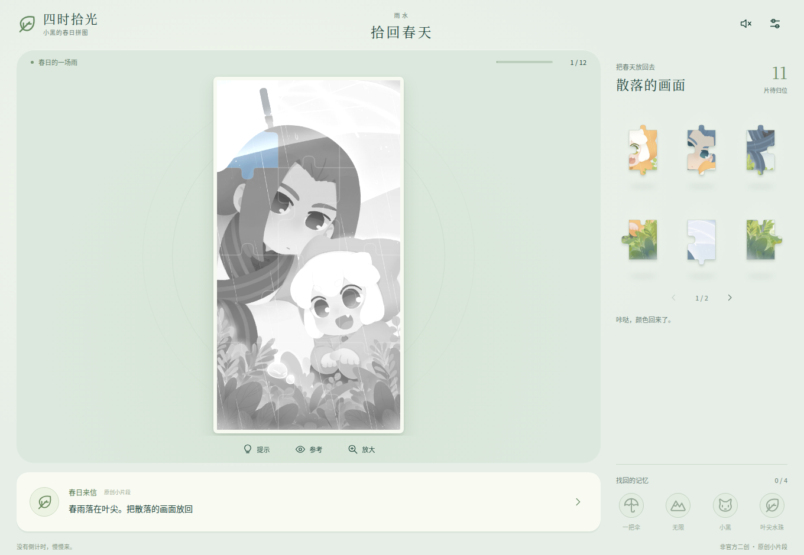

# 小黑的四时拾光

把画面拼回春天，或为雨夜小屋补瓦、留茶、挂灯。一个非官方二创互动叙事原型。

四季分色、二十四节气逐关点亮与素材准备见 [四时旅程](docs/SOLAR_JOURNEY.md)。

可选的纸板厚度、凹槽与按压归位效果见 [纸板拼图说明](docs/CARDBOARD_PUZZLE.md)。

## 本轮：先把 2D 拼图做好

新增手机单屏布局、抬起悬浮与轻晃、靠近磁吸归位、画面区域解锁、逐字字幕、可选雨声、背景音乐与角色朗读。原有难度与形状存档保留。《借一盏灯》暂缓扩展。

[查看本轮交互与实测截图](docs/PUZZLE_2D.md)

## 试玩

安装 Node.js 22.12 或更新版本后：

```bash
cd web
npm ci
npm run dev
```

打开 http://127.0.0.1:5173/ 。首页是新的单屏 2D 拼图。右上角开启声音、进入设置；原生填色故事仍可直接访问 `/prototype/index.html`。

原生 HTML 入口仍保留：`prototype/index.html`、`prototype/puzzle.html` 可以离线双击，也可以从仓库根目录运行 `python3 -m http.server 8765 --bind 127.0.0.1` 后访问。

## 当前玩法

| 体验 | 内容 |
|---|---|
| 拼图 | 12 / 24 / 48 片；方形、经典凹凸、不规则凹凸；九种组合 |
| 拼图辅助 | 空白或灰底拼板、独立原图参考、磁吸开关、按颜色和边角筛选 |
| 填色 | 点击区域高亮，附近浮出色盘；悬停预览，点击确认；支持重涂 |
| 剧情 | 给六个区域填色，依次补瓦、放热茶、挂灯，推进三幕故事 |
| 收尾选择 | 灯挂门边或窗边，画面与最后一句对白不同 |
| 输入方式 | 鼠标 / 触控悬浮拖动、磁吸、点击放置、键盘操作 |



[完整改动与截图](docs/REVIEW.md) · [验证范围](docs/TESTING.md) · [对白审阅稿](docs/DIALOGUE_SCRIPT.md) · [React 开发说明](web/README.md)

2020 年冬季六图的原创区域故事、36 段静态中文录音及桌面/手机截图见 [冬季内容说明](docs/WINTER_STORIES.md)。

## 代码结构

- `prototype/`：无构建依赖的 SVG 填色与剧情；保留旧十二片 HTML 拼图。
- `web/src/`：React 拼图、共用边界几何和样式。
- `web/scripts/prepare-public.mjs`：把唯一的填色源码复制到 Vite 服务和构建目录，避免维护两份实现。
- `tests/`、`web/tests/`：剧情规则、DOM 交互、几何和真实浏览器测试。
- `docs/screenshots/`：浏览器实拍截图，不是设计稿。

## 检查

```bash
cd web
npm test
npm run test:model
npm run test:dom
npm run build
npx playwright install chromium
npm run test:browser
```

React 页面使用独立存档键；原生填色与旧 HTML 拼图保留原有键。不同 HTTP 端口、域名和 file:// 是独立存储环境，存档不自动互通。

目前不规则拼图仍有大致行列结构；没有碎片旋转、自由散放、成组合并或视频。已接入剧情的节气使用仓库内的普通中文合成录音，系统中文朗读作为兜底；字幕为原创二创片段。

## 素材

当前试玩包含 2020 年二十四节气图，春季六图均有区域剧情和普通中文配音；运行图片和录音随 Git 保存，无需设备中文语音。详见 [春季剧情与资源发布](docs/SPRING_STORIES_RESOURCES.md)。原图权利归原权利人，来源见 [素材说明](docs/ART_SOURCE.md)。新增故事为原创二创练习，非官方剧情。

普通中文配音试听及本地音频准备见 [中文配音说明](docs/CHINESE_VOICE.md)。
