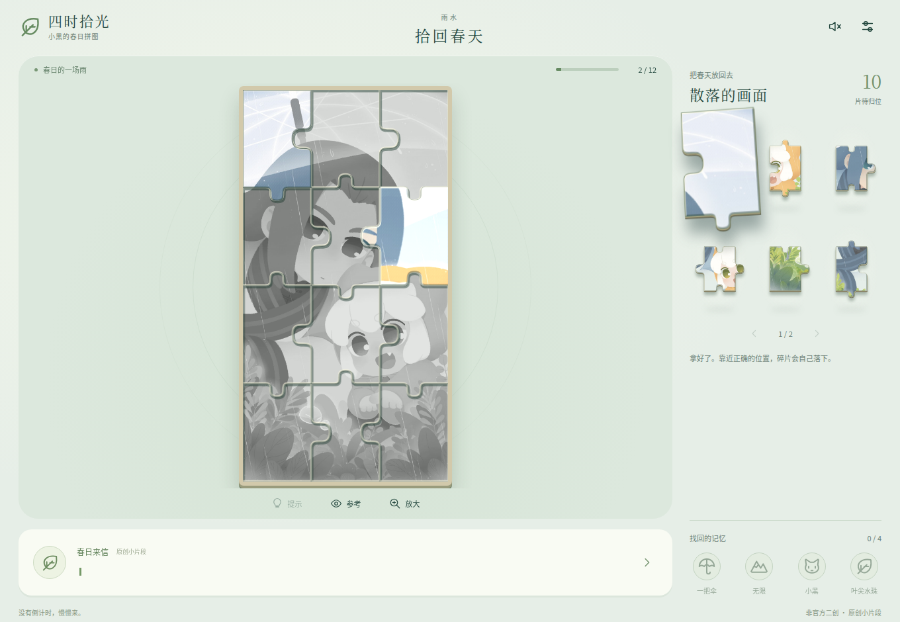
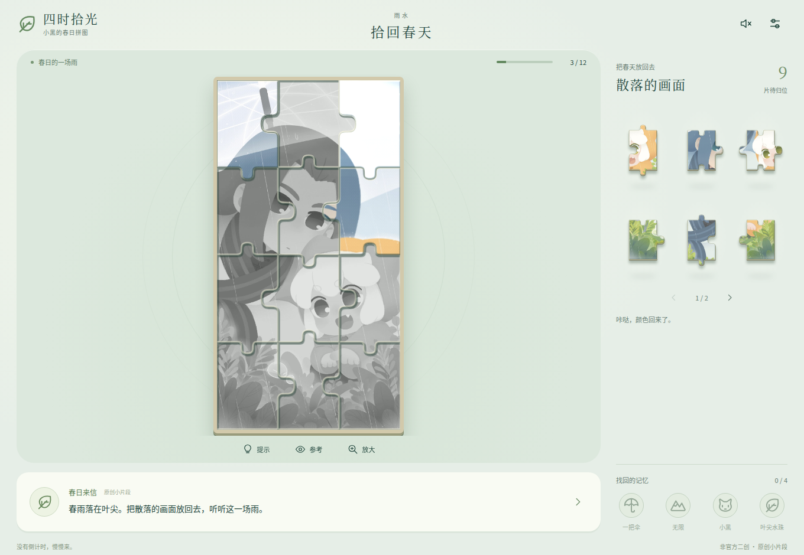
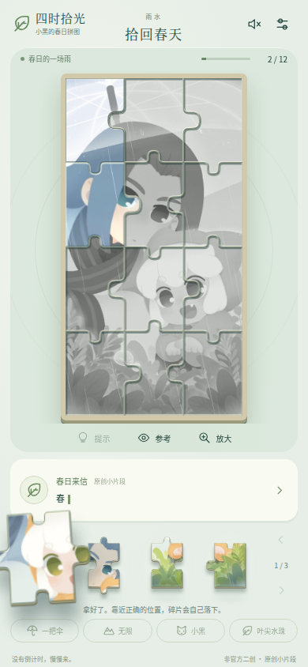
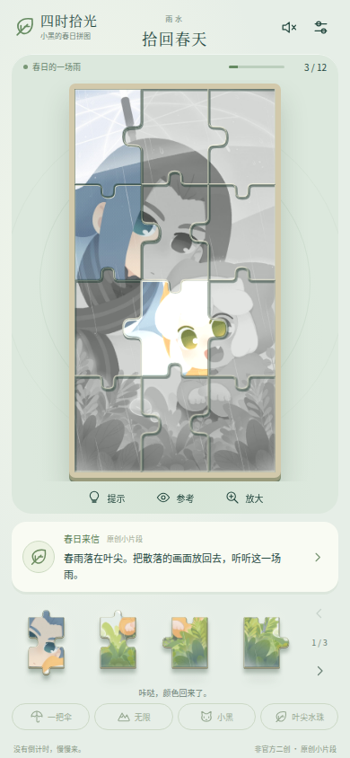

# 可切换的纸板拼图质感

保留当前的「轻盈」效果，新增「纸板拼图」选择。在「游戏设置 → 拼图质感」切换，不重开游戏、不改变难度或形状、不删除已有进度。默认仍是轻盈，选择单独保存在 `shiguang-material-v1`；存储受阻时仍可在当前页面切换。

## 画面与手感

| 位置 | 纸板模式 |
|---|---|
| 未归位的格子 | 按真实拼块路径绘制浅凹槽、内缘明暗与接缝 |
| 碎片栏与拿起的拼块 | 纸板侧边、两层厚度、切边高光与轻微纸纹 |
| 拖动 | 轻微透视倾斜，阴影离开底面 |
| 靠近正确位置 | 230ms 贴合定位，再用 200ms 轻压到凹槽内，阴影收紧 |
| 手机松手 | 动画结束且手指松开后才提交放置；保留触摸源到 touchend，避免移除源元素后吞掉下一次点击 |
| 单击或键盘放置 | 原有放置规则不变，增加短促按入与亮边反馈 |
| 减少动态效果 | 不播放过渡、按压动画或悬浮透视；触屏在松手时完成放置 |

这是一套 SVG 与 CSS 的 2.5D 表现，没有新增 3D 引擎、实体碰撞、力度识别或真实纸板扫描素材。拼块轮廓、目标位置、磁吸距离、三种形状和难度规则沿用原实现。

## 视觉约定

沿用原有春雨画面与布局，把立体变化集中到拼块和底板。叶绿 `#51765e`、墨绿 `#24483f` 与纸白 `#f9fbf3` 保持页面识别；增加纸板侧边 `#b4ac87`、深切边 `#736c55` 和底板 `#d2c9ab`。标题、正文仍使用原有中日韩 Serif / Sans 字体栈，不加载外部字体。

```text
拿起                    贴合                  松手嵌平
图面＋切边＋纸板厚度  →  对齐凹槽、缩短阴影  →  归位保存、留下细接缝
```

不改变主布局、原图与收藏素材，不增加外网请求。旧 `prototype/` 离线入口和全部 `shiguang-react-v1-难度-形状` 存档保持原样。

## 验证

```bash
cd web
npm test
npm run test:model
npm run test:dom
npm run build
npm run test:material-browser
BROWSER_SCOPE=focused npm run test:browser
```

`test:material-browser` 在独立的 5189 端口启动 Vite，退出时关闭；需要 Playwright Chromium，可通过 `CHROMIUM_PATH` 指定本机已有浏览器。`MATERIAL_SCOPE=reduced` 可只复查减少动态效果的路径。

| 层级 | 验证范围 |
|---|---|
| Node / jsdom | 既有几何、存档、玩法、场景规则与 23 项 DOM 交互检查；不用于证明立体视觉、动画或真实触摸 |
| 真实 Chromium 桌面 1360×940 | 质感切换和刷新恢复、旧存档、鼠标拖动、按压阶段取消、键盘归位、九种难度/形状组合各放置一片 |
| 真实 Chromium 手机网页 | 390×844、375×667、320×568，真实触屏事件模拟拿起、按压、松手、取消、切换与布局；小屏无横向溢出，画板位于屏幕内 |
| 减少动态效果 | 无动画；松手后直接完成，下一次触屏设置点击正常响应 |
| 取消与存储 | 按压取消后等过原定归位时间，模型与存档均未增加该片；存储受阻仍可切换质感 |
| 原有轻盈模式 | focused 浏览器回归，包括悬浮、磁吸、失败回弹、键盘、触屏、缩放、布局及声音调度 |

手机检查使用浏览器模拟，尚未在实体手机、Safari 或 Firefox 验证性能与实际手感。本轮没有重新跑九组合全通关；九组合几何规则与各一片新材质放置分别检查。

## 实测画面








手机小屏与窄屏的截图也保存在同一目录。静态截图只能展示质感，按压过程需要在网页中拖动试玩体验。
