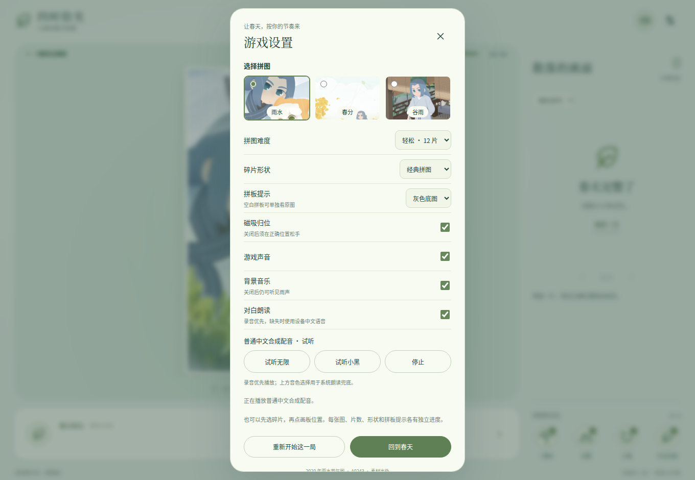
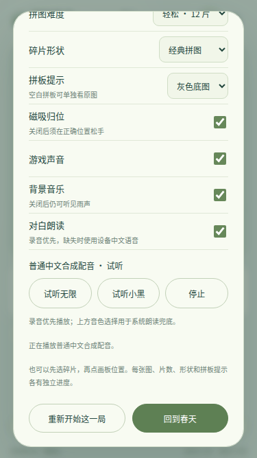
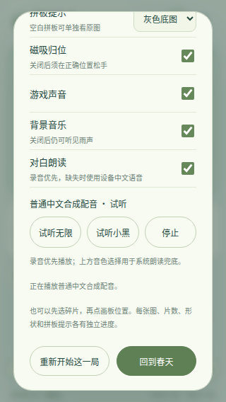

# 普通中文配音试听

当前拼图的三张节气图的十八句对白可先合成为 MP3，播放时不再要求设备安装中文系统语音。声音是普通中文合成试听，不是角色原配音演员的声音。无限使用放慢、降低音高的 Yunxi 男声；小黑使用 Yunxia 年轻男声，向男孩子的轻快听感调整；开场、收尾保留 Xiaoxiao 女声。小黑的合成源是男声，实际年龄感需要人工试听确认，不能仅凭音色名称保证是男童。系统朗读兜底仍取决于设备提供的声音。

## 桌面与手机使用

1. 打开「游戏设置」，开启「游戏声音」。
2. 点「试听无限」或「试听小黑」；试听不要求先开启自动对白朗读，不解锁记忆或改变存档。
3. 点「停止」可立即停止。切换角色不会叠音。
4. 开启「对白朗读」后，新的区域对白和已解锁记忆的回看会优先使用录音。

手机与桌面使用相同入口，试听按钮至少 44px 高。小屏设置弹窗可上下滚动，底部按钮仍可到达。

| 情况 | 行为 |
|---|---|
| 有本地配音文件 | 优先播放 MP3，无须系统中文语音 |
| 文件缺失或损坏 | 尝试系统中文朗读；等待语音列表更新，最多 1.5 秒 |
| 两种声音都不可用 | 提示原因，字幕、拼图和独立音效继续运行 |
| 浏览器阻止自动播放 | 显示提示，可点击试听按钮重试 |
| 静音、切换对白、下一句、切到后台 | 停止当前对应播放，避免旧请求恢复声音 |
| 打开设置 | 停止游戏对白；设置中的试听不会被旧字幕的定时清理打断 |

字幕队列同时等待文字展示时间与音频结束，防止长句被原有字幕定时器截断。加载超过 8 秒会尝试系统朗读；单句播放超过 30 秒会结束等待，避免卡住后续字幕。原有拼图存档键与数据不变。

## 准备本地音频

项目按约定不提交生成的音频和模型。新 checkout 需要先生成一次；生成需要联网，运行游戏时只请求随网页提供的静态 MP3，不调用在线合成服务。没有准备文件时仍可使用系统朗读或字幕。

在仓库根目录执行：

```bash
python3 -m venv /tmp/xiaohei-tts-venv
/tmp/xiaohei-tts-venv/bin/python -m pip install edge-tts==7.3.1
cd web
TTS_PYTHON=/tmp/xiaohei-tts-venv/bin/python npm run audio:generate
npm ci
npm run dev
```

`audio:generate` 使用 Node 内置模块和指定 Python 环境，不依赖先安装网页包。只有这条命令会把现有游戏对白发给在线合成服务；`npm run dev` 和 `npm run build` 不会联网生成声音。

生成文件位于 `generated-audio/dialogue/`，附本地 `manifest.json` 记录服务、音色、参数、文本和生成时间。脚本以临时文件生成、成功后替换目标文件。`prepare-public.mjs` 将匹配当前文本和音色参数的文件复制到忽略的 `web/public/audio/dialogue/`；构建时再进入 `web/dist/`。文件名随文本和音色配置变化，避免台词修改后误用旧音频。

音频准备完成后，静态站点可在没有外网的环境播放。这里的 React 网页仍沿用既有 Vite 构建方式；旧 `prototype/` 无构建、离线运行入口保持原样。

工具来源：[edge-tts 官方仓库](https://github.com/rany2/edge-tts)。本轮使用 7.3.1；7.2.7 在本机调用时返回 403，更新客户端后完成合成。在线服务未来可能变化，生成失败时不会替换已有有效 MP3。试听音频未作正式发行授权评估。

## 验证

```bash
cd web
npm test
npm run test:model
npm run test:dom
npm run build
npm run test:voice-browser
BROWSER_SCOPE=focused npm run test:browser
```

`test:voice-browser` 要求已经生成十八段 MP3，使用独立 5186 端口；既有浏览器回归使用 5174 端口。浏览器由 Playwright 提供，需安装 Chromium；也可用 `CHROMIUM_PATH` 指定已安装的可执行文件。

| 检查层级 | 结果与边界 |
|---|---|
| Node / jsdom | 配音映射与回看、旧文本音频保护、缺失降级、延迟语音、取消、播放受阻、超时和字幕等待；不证明真实音频听感或视觉效果 |
| 真实 Chromium / 本地 HTTP | 使用真实 MP3 解码、播放时间推进、结束事件；没有系统中文音源仍能播放；试听切换、停止、记忆回看和全局静音；无外部网络请求 |
| 桌面 | 1360×940，鼠标操作，无横向溢出 |
| 手机网页 | 390×844、375×667、320×568，真实浏览器触屏事件模拟，试听按钮尺寸与弹窗宽度检查 |

尚未在实体手机、Safari 或 Firefox 验证；浏览器的播放事件不能代替用户对音色、情绪与实际扬声器听感的判断。本轮既有浏览器回归使用 focused 范围，没有重新运行九组合全通关。

## 实测截图






