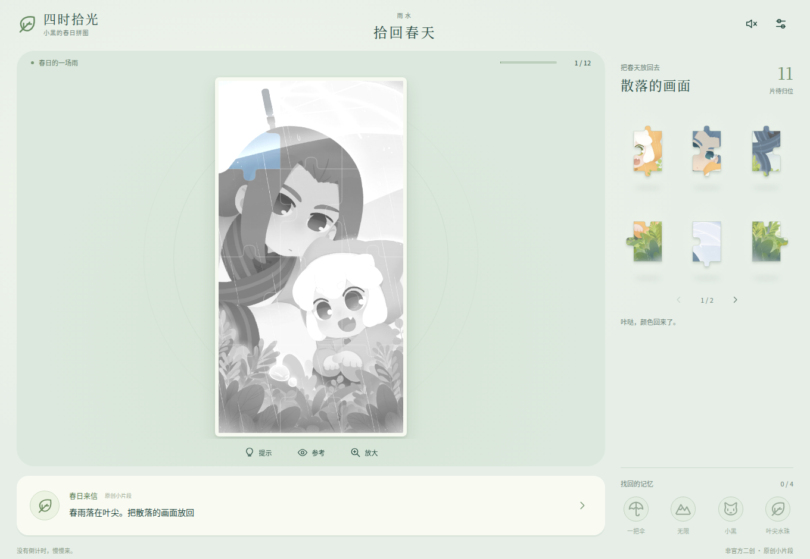
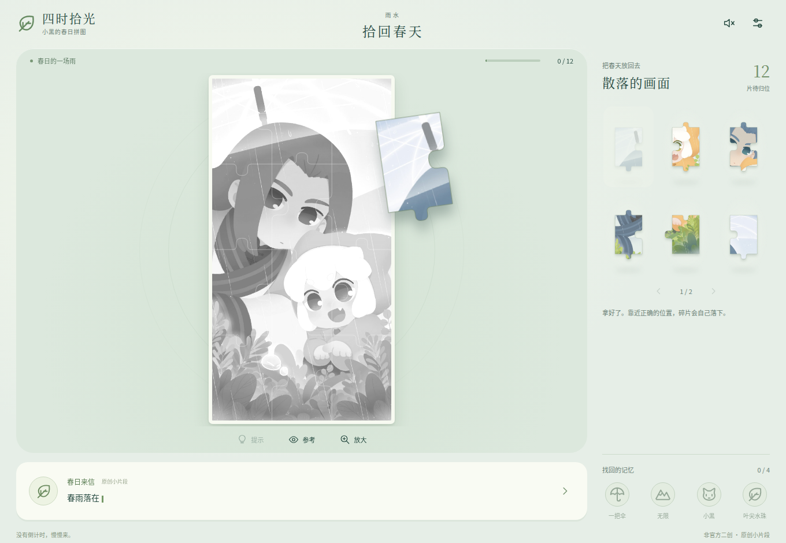
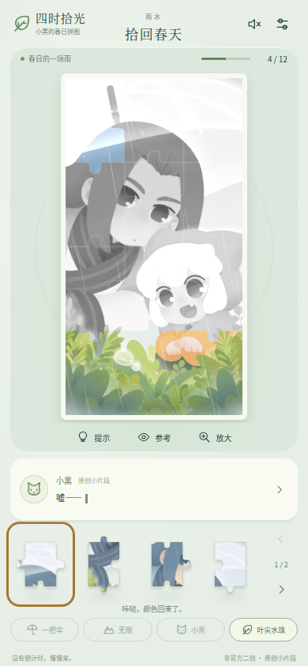
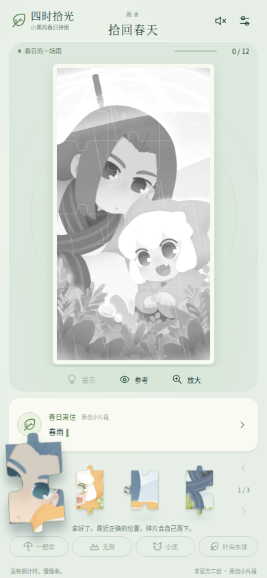

# 2D 拼图：拾回春天

本轮集中完善拼图。《借一盏灯》源码保留，没有扩展原剧情。3D、角色建模和精细分层美术暂缓。

## 试玩

```bash
cd /home/hao/Desktop/github/xiaohei/web
npm ci
npm run dev
```

打开 http://127.0.0.1:5173/ 。右上角可开启声音、进入设置。首次打开默认轻松经典拼图；随后记住上次模式。

| 动作 | 反馈 |
|---|---|
| 按住碎片 | 从碎片栏抬起，显示原画板比例的浮动碎片、阴影与轻微倾斜 |
| 拖动 | 碎片随指针移动，左右移动改变倾角；触屏抬至指尖上方，避免遮住目标 |
| 靠近正确位置 | 依据屏幕距离自动磁吸，不必准确松手；吸附后恢复原色并亮一下 |
| 放错、Esc 或触摸取消 | 不增加进度；放错回到栏中，取消清除悬浮状态 |
| 单击 / 键盘 | 保留先选碎片再点目标位置的方式，支持 Enter / 空格和画板方向键 |
| 提示、参考、放大 | 提示定位当前碎片；参考期间禁止编辑；放大后可平移画板 |

桌面六片、手机四片一页，翻页取下一组。手机画板、字幕、碎片栏位于同一屏；设置收在弹窗中。12 / 24 / 48 片 × 三种形状仍然可选。

## 实测画面








## 按画面解锁，而非按总片数

在 A0243 上人工标记了伞、无限、小黑和底部叶片四块叙事区域。每个难度将区域映射到对应碎片，所需碎片全部归位才触发。区域允许覆盖相同碎片，不是自动语义分割；高难度更接近物件轮廓，12 片模式较粗略。这张图没有清楚独立的花朵，因此使用“叶尖水珠”。

| 画面 | 说话人 | 原创对白 |
|---|---|---|
| 伞 | 无限 | 靠近一点，雨就淋不到了。 |
| 无限 | 无限 | 不赶时间。你想看，就再看一会儿。 |
| 小黑 | 小黑 | 师父，你看！叶子上有一颗小小的天空。 |
| 叶尖水珠 | 小黑 | 嘘——别动。让它在叶子上，再待一小会儿。 |

字幕按字出现，多事件排队，完成后可点亮起的记忆按钮立即回看。刷新只恢复完成状态，不重播历史区域事件。完成整幅画面还有一句收尾。

## 声音与动画的范围

- 声音默认关闭。在右上角开启后，可听到合成的雨声、轻柔旋律和拿起、归位、区域完成的提示音。设置里的「背景音乐」可以单独关闭。
- 雨伞区域拼齐后，底雨声淡下去，叠加不规则的伞面雨滴声。读档会按当前拼图进度选择雨声，重新开始会回到环境雨声。
- 可在设置里开启「对白朗读」。无限的语速较慢、音高较低，小黑更轻快、音高较高。具体音色由设备的中文系统语音决定，原版声优的声音需要另行准备获准使用的录音。朗读时雨声和音乐会降低音量。
- 完成叶片区域时，用原图底部局部遮罩做短暂轻摇与亮点。这是 2D 局部画面效果，不是已经完成叶片去底、背景补绘或骨骼动画。精细拆层素材后续可在 Krita 制作再替换。
- 减少动态效果设置会关闭动画、逐字效果；吸附规则仍有效。

## 实现与存档

- `web/src/gameplay.js`：归位距离、浮动碎片尺寸、区域完成规则。
- `web/src/useFloatingPiece.js`：统一鼠标 / 触控 Pointer Events、指针捕获、吸附、回弹、取消清理。
- `web/src/useDialogue.js`、`useSound.js`：字幕队列、回看、提示音与可选系统语音。
- `web/src/Artwork.jsx`：共用的原图裁片和小图标。
- `web/src/main.jsx`、`style.css`：单屏游戏布局、碎片分页、放大与设置。

沿用 `shiguang-react-v1-难度-形状` 存档数组，不删除或迁移旧进度。HTTP / file://、不同端口仍是独立的浏览器存储来源。

## 验证

- 17 项 Node 测试：九组合邻边吻合、旧存档过滤、四区域完成条件、屏幕坐标和吸附边界。
- Chromium：九组合全通关与刷新恢复；鼠标拿起、悬浮、松手前吸附、失败回弹、Esc 取消、键盘；区域字幕、叶片效果、参考保护。
- 390×844、375×667、768×1024：无横向溢出，画板、字幕、碎片栏位于屏幕内；放大画板可滚动。
- Chromium 真实触控事件模拟：指尖偏移、触摸取消和磁吸归位。不是实物手机测试。
- 通过浏览器测试替身检查三个音轨有有效音频数据、雨伞完成切换混音、音乐可独立关闭、全局静音和两位角色的朗读参数。实际听感取决于设备和系统音源。
- 生产构建通过。

运行完整浏览器检查：`cd web && npm run test:browser`。`BROWSER_SCOPE=focused` 只复查交互、布局、声音等，跳过九组合全通关；已通过的全通关结果与最后一轮针对性检查分别记录，不混同。

未测 Safari、Firefox、真实设备性能。拼块仍是二维平面；后续可先尝试带厚度的图片拼块（2.5D），再讨论完整人物与场景的 3D 重建。
