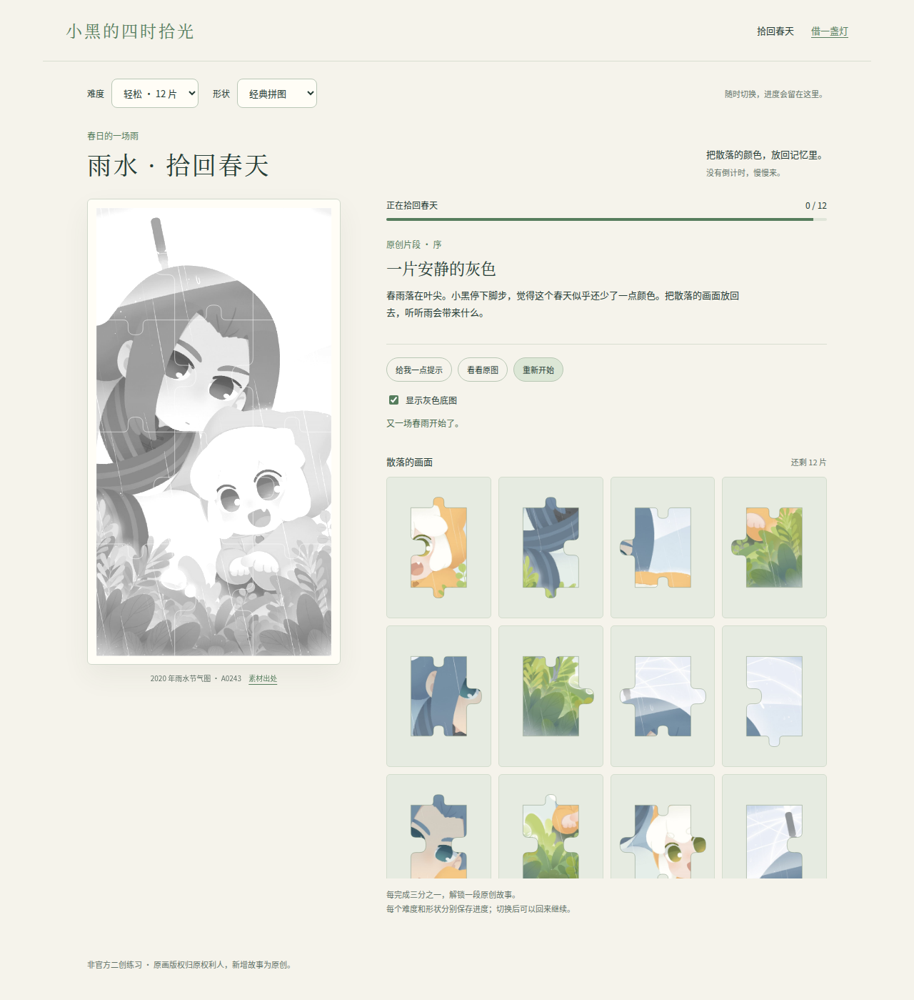
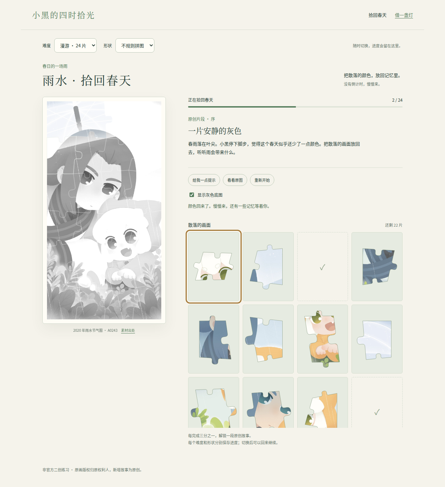
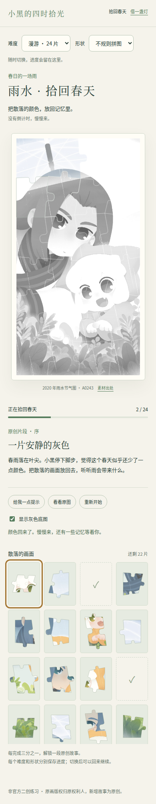
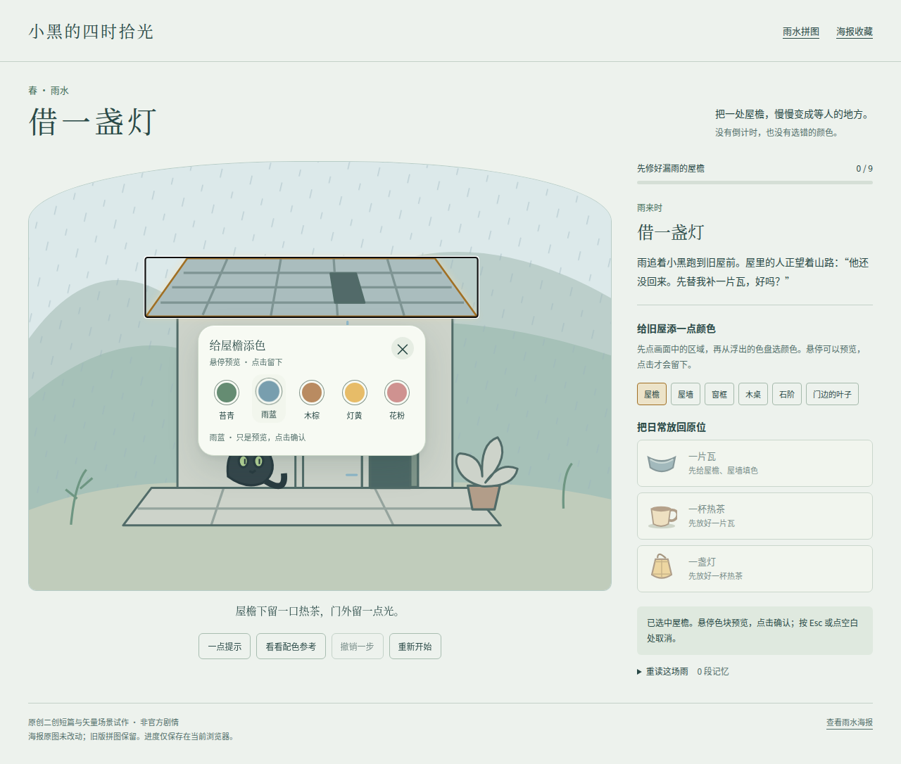
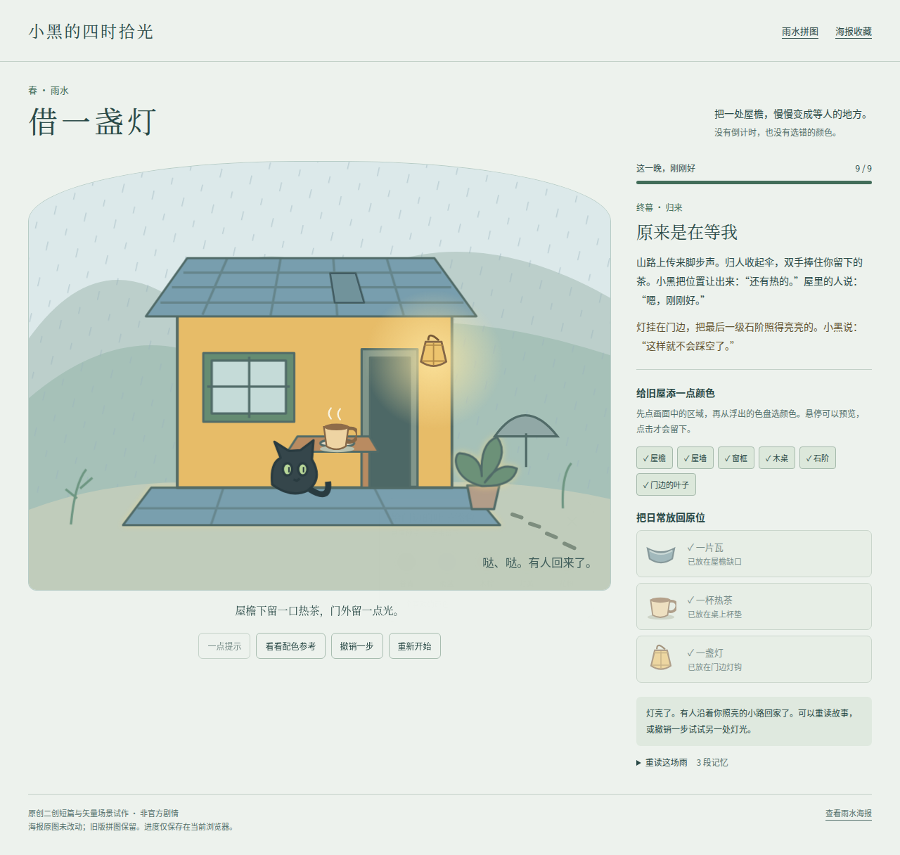
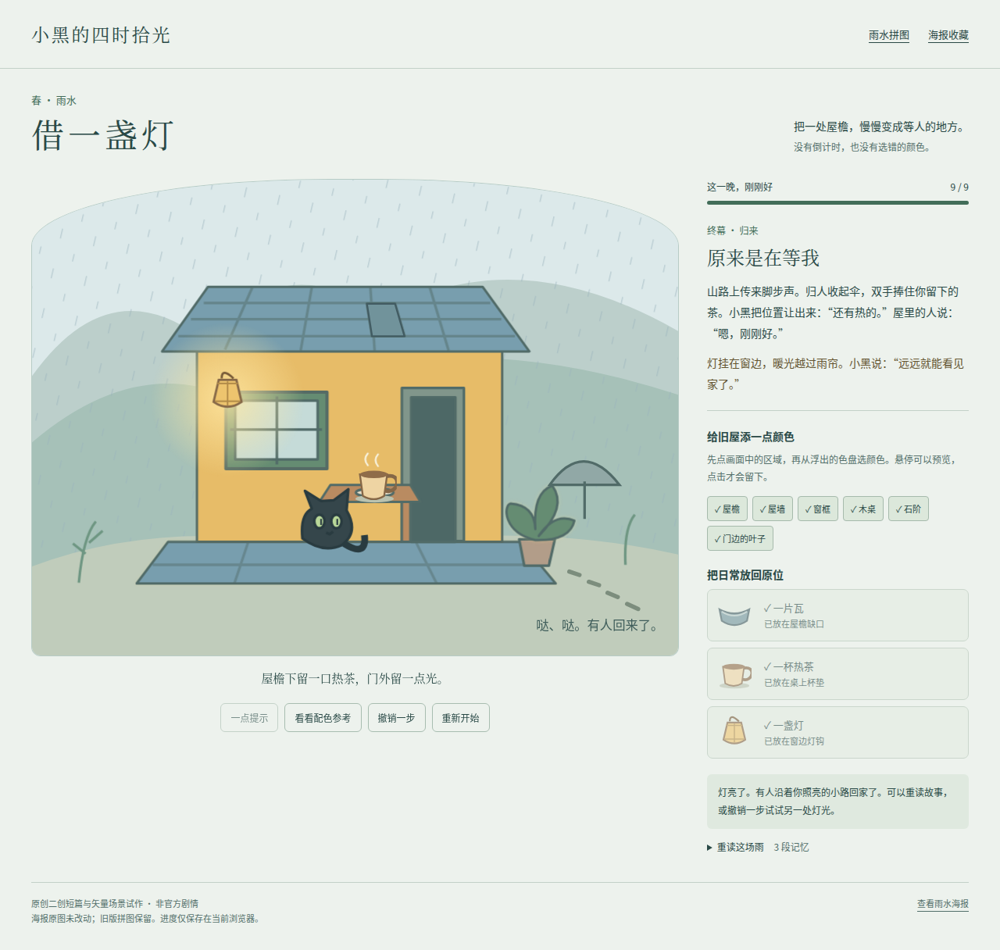
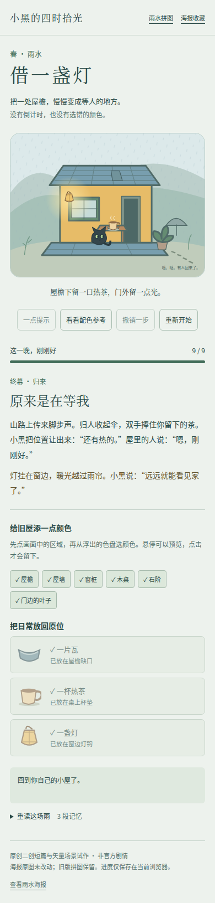

# 本次改动与试玩截图

从只有说明文件的 main，补齐可运行的互动叙事原型，并提供 React 拼图和本地 HTTP 入口。原有本地海报收藏与工作目录不被覆盖。

| 改动 | 用户能观察到的效果 |
|---|---|
| React + Vite 本地应用 | `npm ci && npm run dev` 后通过 HTTP 试玩，无需让测试浏览器打开 file:// |
| 12 / 24 / 48 片 × 三种形状 | 九种组合分别保存进度；相邻凹凸边共用几何，不靠视觉伪装 |
| 扰动网格拼图 | 不规则模式的切线和块形有变化，仍保留大致行列结构 |
| 区域优先的填色 | 点屋檐等区域高亮，浮动选色；悬停预览不保存，点击才落色 |
| 三幕摆物剧情 | 补瓦止雨、热茶升汽、挂灯照路；灯的两个位置有不同收尾 |
| 可复现的验证 | 锁定依赖、模型/DOM/浏览器测试、真实页面截图 |
| 对白审阅稿 | 为“放好物件 → 一句对白”整理文本与触发约定；音频尚未接入 |

## 拼图

经典凹凸拼图，12 片：

不规则凹凸拼图，24 片，已放好两片：

手机纵向布局（390px 浏览器模拟）：

## 填色与短剧情

点击屋檐，再悬停“雨蓝”预览。截图展示选区、浮动色盘与预览，操作尚未计入进度：

灯挂门边，照亮最后一级石阶：

撤销挂灯后改挂窗边，收尾对白随之改变：

手机填色故事页：

## 审核时建议试玩

1. 切换到 24 片不规则拼图，放好两片；切到别的模式后再回来，检查进度保留。
2. 进入“借一盏灯”，点击区域并悬停色块，确认预览不会保存。
3. 依次补瓦、留茶、挂灯；撤销一次再换灯的位置，比较两句收尾对白。
4. 审阅 [对白稿](DIALOGUE_SCRIPT.md)，确定语气后再接声音模型。

## 当前限制

没有自由散放、旋转、碎片成组合并、Voronoi 全自由切割。手机测试为 Chromium 触控模拟，非真实手机硬件。动画由浏览器渲染并检查截图，没有性能基准或跨浏览器验证。填色页是 SVG 试作场景；没有自动拆分海报。原生入口可离线打开，但自动浏览器检查走真实 HTTP。声音、视频和原演员声音克隆均未实现。
