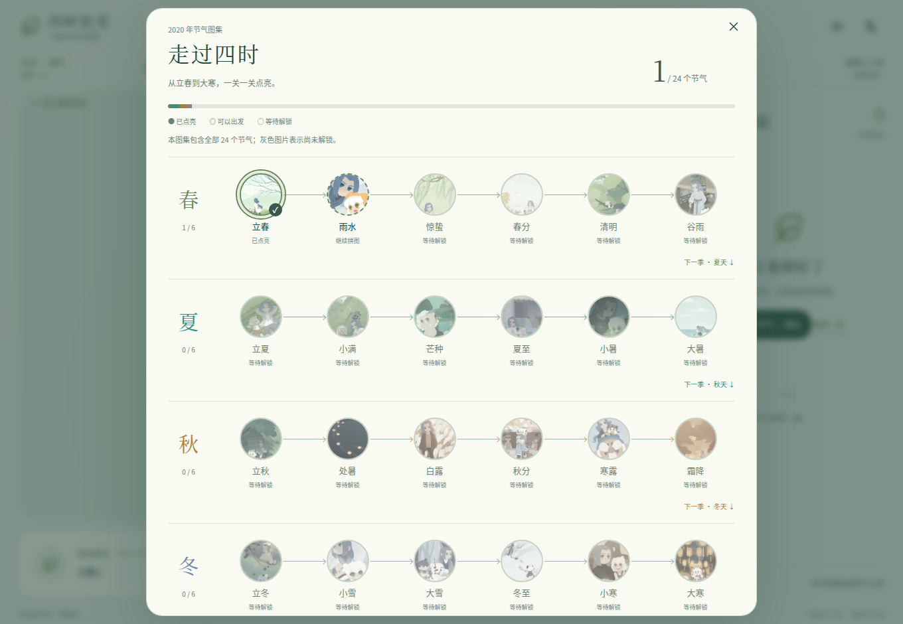
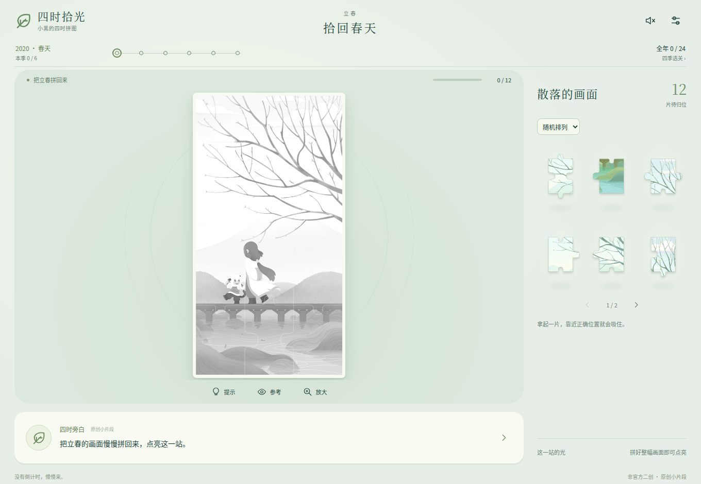
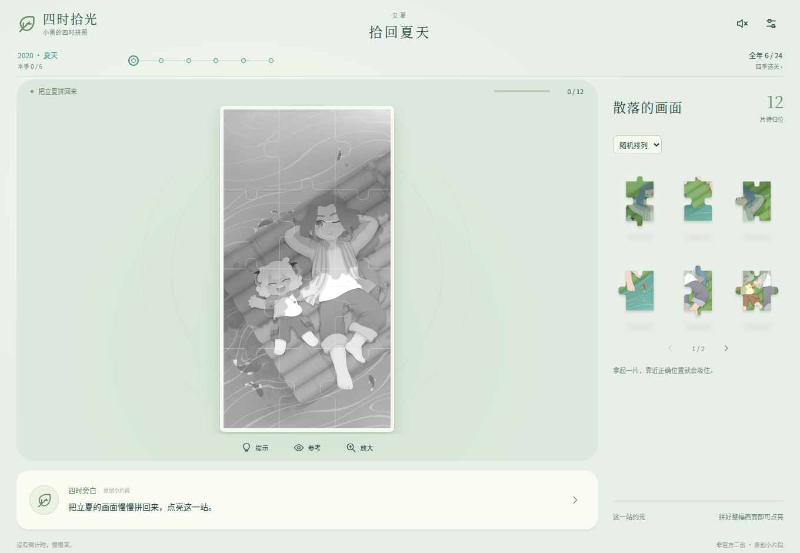
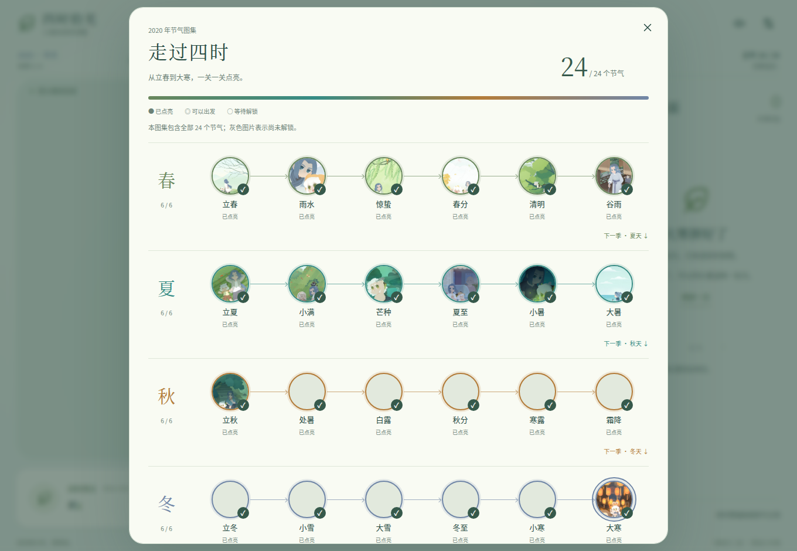
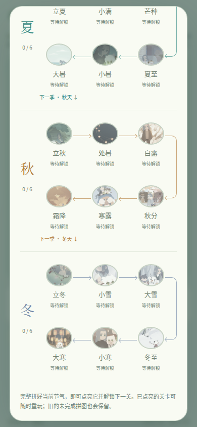
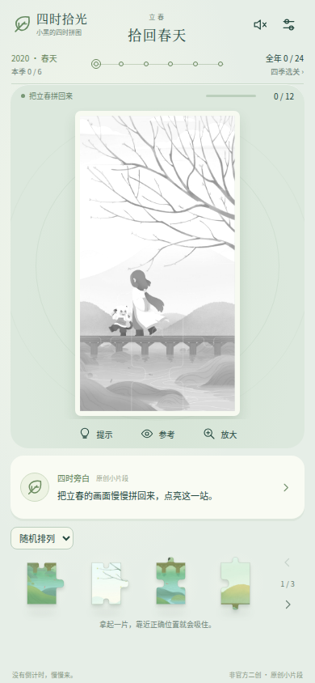
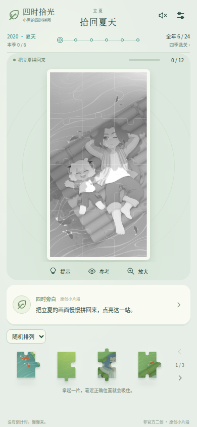
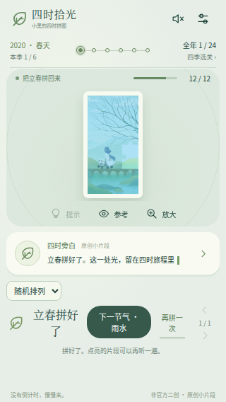

# 四时旅程：二十四节气逐个点亮

首次游玩从立春出发。拼图页顶部只显示当前季节的六个节点、本季点亮数与全年总数；完整四季仅在选关地图展示。点击顶部「四季选关」或在设置里选择节气，可以打开四季路线图。春绿、夏青、秋金、冬蓝，每季六个节气，按节气顺序从立春走到大寒。

| 状态 | 行为 |
|---|---|
| 当前可进入 | 轮廓高亮，点击继续拼图 |
| 完整拼好 | 对应节点实心点亮，解锁下一个节气，并出现「下一节气」按钮 |
| 尚未解锁 | 灰色节点，不能跳过前一关直接进入 |
| 已点亮 | 可随时重玩，重新开始该拼图不会熄灭历史节点 |

任一片数、形状或拼板提示模式下完整完成一张图即可点亮该节气。春季六个节气均有四个区域剧情和录音，详见 [春季剧情与资源](SPRING_STORIES_RESOURCES.md)。夏秋冬其余十八个节气仍提供简短开场与通关文字。

## 手机路线与当前季节

桌面六个节点从左到右连接；手机采用三列折返，DOM 和键盘顺序仍为真实节气顺序：

```text
立春 → 雨水 → 惊蛰
               ↓（右侧折返线）
谷雨 ← 清明 ← 春分
↓ 下一季：夏天
```

箭头不经过节点文字。未解锁的缩略图保留可辨认的画面，状态文字说明「等待解锁」。实际图片请求失败则显示「图片未载入」，与锁定状态区分；不会仅留下一个看似空白的圆圈。

拼图页随当前关卡切换季节，例如进入立夏只显示夏季六个节点，本季 0/6、全年 6/24；不会继续摆出其他三个季节的圆圈。地图与拼图页均明确标记 2020 年。

## 素材与来源

使用现有本地收藏的 2020 年同系列，每个节气选一张，不混入标题带「二」的另一版。二十四张图片均按收藏目录的 SHA-256 实际核验；没有修改原始字节、覆盖原图或重新下载。

`web/src/solarTerms.js` 保留每张图的原始目录相对路径、素材编号、SHA-256、尺寸和第三方收录页。原作权利仍属于原权利人，第三方目录的收录不等于逐张核实了官方首发，也不代表获得正式再分发许可。当前精选二十四张运行图已随 Git 提交至 `web/public/art/`，原始大收藏不提交、不修改。

节气顺序参考 [香港天文台二十四节气](https://www.hko.gov.hk/sc/gts/time/24solarterms.htm)；四季分组为立春至谷雨、立夏至大暑、立秋至霜降、立冬至大寒，各六个节气，可参见 [香港教育局廿四节气表象图](https://www.edb.gov.hk/attachment/tc/curriculum-development/kla/pshe/references-and-resources/ethics-and-religious-studies/Nan_Lian_Garden/data7.pdf)。这是季节循环的关卡顺序，不硬编码节气的公历日期。

### 其他年份

本地收藏目录及实际文件的核验结果如下。这里的「完整」指目录中该年份的标准版二十四节气均已保存且 SHA-256 匹配，不等于逐张核实了官方首发。

| 年份 | 标准版节气图 | 本次接入 |
|---|---|---|
| 2020 | 24/24 | 是，当前图集 |
| 2021 | 24/24 | 否 |
| 2022 | 24/24 | 否 |
| 2023 | 24/24 | 否 |
| 2024 | 24/24，另有诗词版本 | 否 |
| 2025 | 24/24 | 否 |

这次地图中的灰色节点并非当年没有发布图片：2020 年所选二十四张全部存在。后续接入其他年份应提供年份选择和独立存档，不能直接替换 2020 图片、复用当前节气 ID 覆盖旧进度。本次没有接入年份切换或声称所有年份都有完整官方目录。

## 准备和试玩

正常 checkout 已带齐当前图集与春季录音：

```bash
cd web
npm ci
npm run dev
```

`predev` / `prebuild` 核验 Git 中的资源清单，缺失或损坏则失败。无需收藏目录、Python 或在线 TTS。只有维护者重新发布修改后的媒体才需要本地源素材；详见 [资源发布说明](SPRING_STORIES_RESOURCES.md)。旧 `prototype/` 无构建离线入口保持原样。

## 存档兼容

- 原有 `shiguang-react-v1-片数-形状` 雨水灰底存档，以及 `shiguang-puzzle-图片-拼板-片数-形状` 存档键与内容保持不变。
- `shiguang-solar-journey-v1` 只保存版本与已点亮的节气 ID，不保存未知日期或虚构的游玩时间。
- 首次读取时检查各模式的真实拼图存档：完整完成的旧图直接点亮；已有部分进度的旧图仍可继续。不会把没有完成的前置节气推断为已完成。
- 旧图的实际完成可以解锁其紧邻的下一关；因此旧玩家可能先看到雨水亮着、立春仍未亮。这保留历史事实，立春仍可进入补拼。
- 已点亮节点独立保留，重玩、重置某局或切换模式不会熄灭它。损坏的旅程 JSON 不会阻断读取有效的旧拼图存档。
- 存储受阻时仍可在当前页面游玩、点亮和解锁，并提示本次进度可能无法持久保存。

## 验证

```bash
cd web
npm test
npm run test:model
npm run test:dom
npm run build
npm run test:journey-browser
```

真实浏览器检查使用独立的 5190 端口，需要 Playwright Chromium，也可用 `CHROMIUM_PATH` 指定浏览器。`JOURNEY_SCOPE=mobile-narrow` 可单独复查小屏。

| 检查 | 结果与范围 |
|---|---|
| Node | 新增七项：二十四节气顺序、逐关解锁、重玩不熄灭、旧存档导入、所有模式识别、损坏 JSON、存储受阻；既有几何、玩法和场景模型检查通过 |
| jsdom | 既有 23 项填色 DOM 交互检查通过；不用于证明画面或触屏效果 |
| Chromium 桌面 1360×940 | 真实键盘输入从立春连续完成二十四关，逐关点亮和下一关跳转，最终刷新恢复 24/24 |
| Chromium 手机网页 | 390×844、375×667、320×568，触屏拖动、点按完成首关、下一关可进入、刷新恢复、无横向溢出，画板与碎片栏位于屏幕内 |
| 边界 | 旧三张图存档实际读回；图片加载失败时不能通关；存储受阻提示并保留当前会话可玩 |
| 既有功能回归 | 配音原生 MP3 四尺寸、纸板四尺寸及减少动态、既有三图剧情/参考/磁吸/音效调度检查通过；旧测试使用明确存档场景并改走新版选关入口 |
| 本地素材 | 二十四张准备后的图片全部匹配已有目录 SHA-256；浏览器检查没有外部网络请求 |

连续键盘通关时还修正了旧的延迟自动聚焦：用户已经转移焦点时，不再把焦点抢回碎片栏。320×568 小屏单独压缩了旁白与碎片区，降低画板最小高度，避免新增进度条挤掉底排目标。对应路径在修改前复现失败，修复后通过，没有通过额外测试等待掩盖。

本次冲突解决与界面调整后，已重新完整运行桌面二十四关和三种手机尺寸；另外检查了手机折返节点坐标与可见连线、二十四张缩略图真实载入、当前季节仅六个节点、夏季独立计数及缺图提示。夏季手机截图使用已完成春季的存档场景，不代表本次在手机完整通关四季。未在实体手机、Safari、Firefox 验证；本轮没有重跑所有片数/形状组合的完整二十四关。未合并 PR 或部署。

## 实测截图

PR 描述直接嵌入以下九张，不要求先点开本文：










