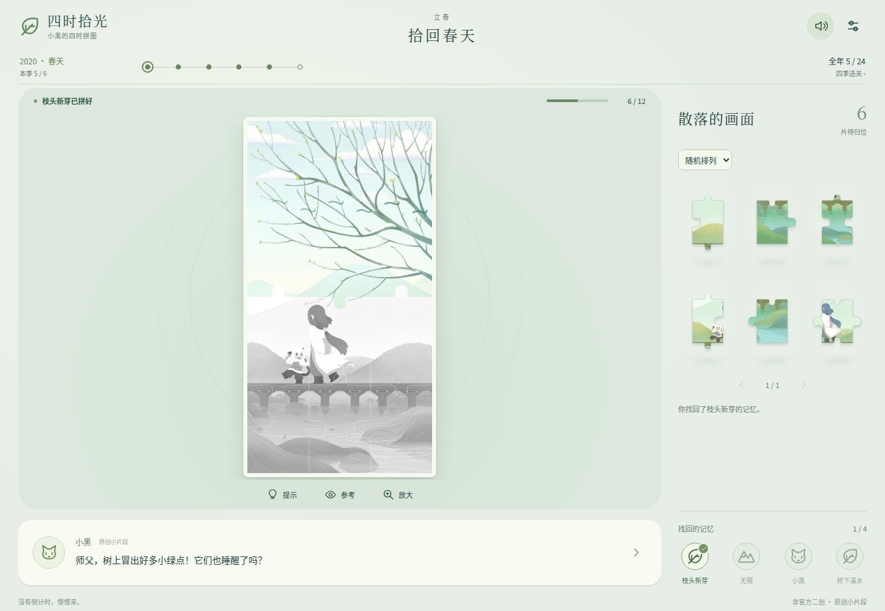
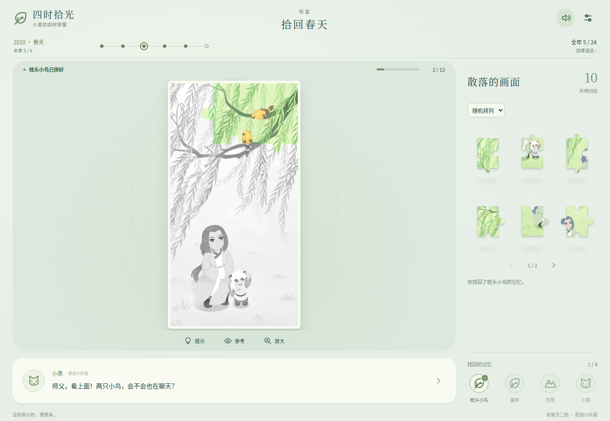
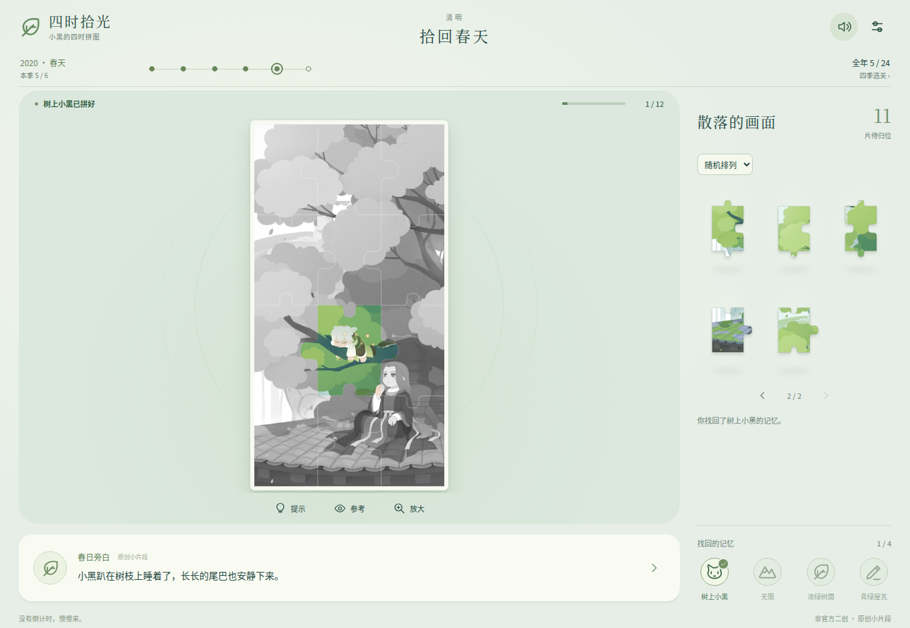
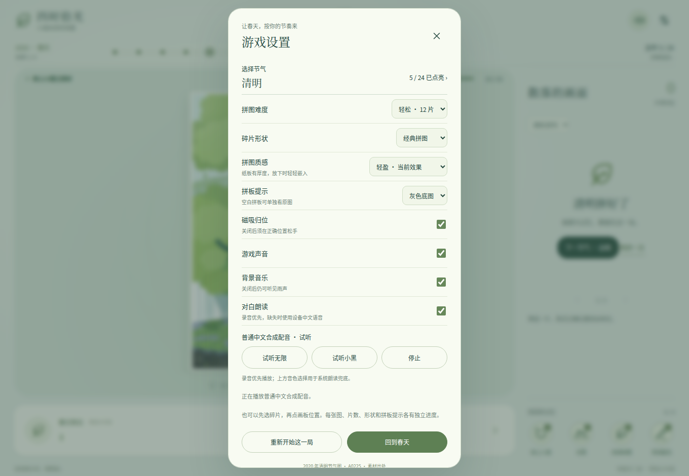
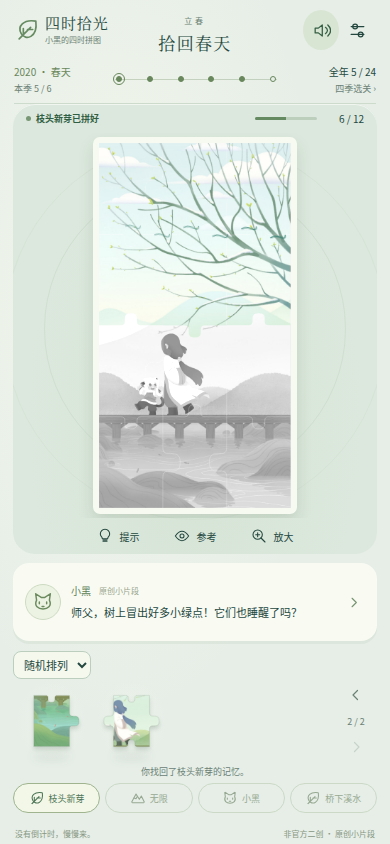
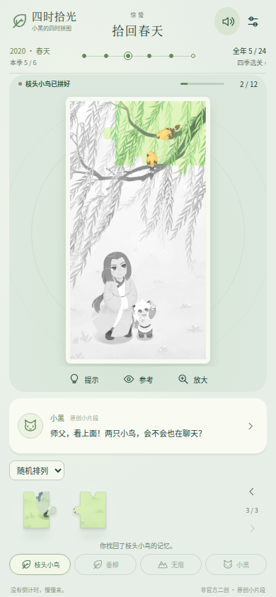
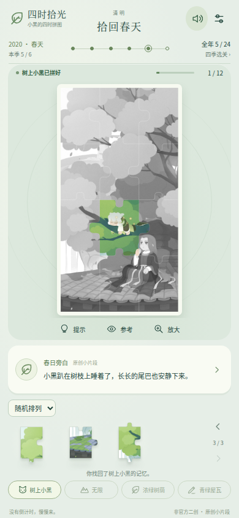
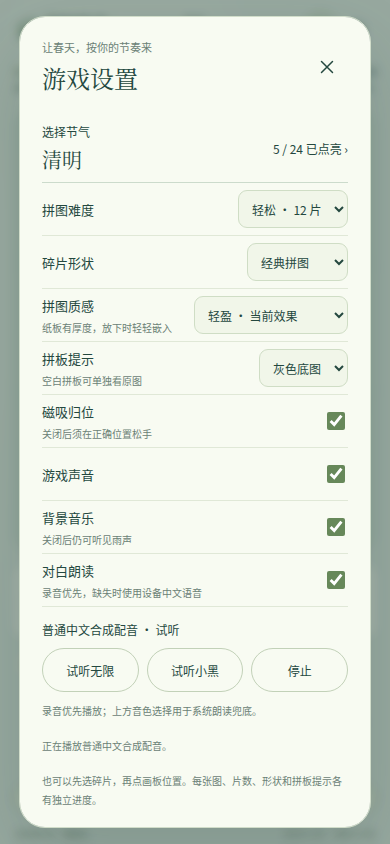

# 春季六节气剧情与可发布资源

春季六张 2020 年节气图均有四个按原图位置标注的记忆区域、开场和收尾，共 36 段普通中文合成录音。故事是依据画面的原创二创小片段，不是官方台词或剧情。角色音色沿用小黑的 Yunxia 年轻男声、无限的较低沉 Yunxi 男声和 Xiaoxiao 旁白；没有模仿原配音演员。

| 节气 | 画面与区域 | 本次内容 |
|---|---|---|
| 立春 | 枝头新芽、无限、小黑、桥下溪水 | 新增；先拼新芽，再留意桥边的人物与水面 |
| 雨水 | 雨伞、无限、小黑、叶尖水珠 | 保留既有剧情与录音 |
| 惊蛰 | 枝头两只小鸟、垂柳、无限、小黑 | 新增；小黑抬手看鸟，无限提醒轻声观察 |
| 春分 | 纸鸢、无限、小黑、花田 | 保留既有剧情与录音 |
| 清明 | 睡着的小黑、无限、树荫、屋瓦 | 新增；小黑睡着的区域使用旁白，避免让睡着的角色凭空说话 |
| 谷雨 | 沙画、屋檐、无限、小黑 | 保留既有剧情与录音 |

区域是手工标记的游戏范围，不是自动物体分割。每个片数下都由该区域所需的碎片解锁；回听只重播对白，不修改拼图进度。详细标注与台词在 `web/src/puzzleStories.js`。

## 为什么没有系统中文声音也应该能播放

网页先播放同站点的 MP3。以前 `generated-audio/` 和 `web/public/audio/` 均被 Git 忽略，只有当前机器有文件；干净 checkout / Preview 加载不到录音，才尝试系统语音。截图中的「录音暂不可用，未找到中文系统语音」表示这两个路径都没有成功。

现在审核后的 36 段录音提交在 `web/public/audio/dialogue/`，当前 2020 图集的 24 张图也一并提交在 `web/public/art/`。实验音频、模型、其他年份原图与整个收藏继续保留在本地。录音文件名包含台词与音色配置的哈希；`web/resources-manifest.json` 记录实际大小、SHA-256、台词和合成参数。

`predev` / `prebuild` 只核验当前代码要求的资源，再准备旧填色入口。不删除录音、不从本地收藏复制，也不调用合成服务。缺失、损坏或清单落后台词时构建失败，避免发布没有配音的网页。

## 体积与 ZIP 比较

本次按字节实测，MB 为十进制；ZIP 使用 DEFLATE，资源本身未再改图或转码。

| 内容 | 文件数 | 原始大小 | ZIP 大小 | 节省 |
|---|---:|---:|---:|---:|
| 当前图集 | 24 | 6,352,601 bytes（6.35 MB） | 6,308,051 bytes | 0.70% |
| 春季配音 | 36 | 1,128,528 bytes（1.13 MB） | 980,159 bytes | 13.15% |
| 合计 | 60 | 7.48 MB | 约 7.29 MB | 约 2.6% |

这些是 JPEG/PNG 和 MP3，已经过压缩。当前直接保存所选运行文件更合适：能按单个文件审阅/更新，浏览器按需加载，不用每次构建解压或运行时下载 ZIP。没有将 ZIP、全套收藏或模型加入 Git。

## Vercel 如何发布

[Vercel 支持自定义 Build Command 和 Output Directory](https://vercel.com/docs/builds/configure-a-build)。技术上可以在 build 命令中先解压资源再构建；但这不会减少最后需要托管的解压后文件，也需要维护压缩包和校验过程。这次采用直接静态资源，省掉这一步。

[Vite 会把 public/ 中的文件原样复制到 dist/](https://vite.dev/guide/assets.html#the-public-directory)。浏览器请求例如 `/audio/dialogue/文件名.mp3`，由同站点静态托管提供；不经过浏览器 TTS、GitHub raw 链接或后端合成 API。

根目录已提供 `vercel.json`。适配现有 Vercel Project，Root Directory 保持 `web`：

| 设置 | 值 |
|---|---|
| Framework | Vite |
| Install Command | `npm ci` |
| Build Command | `npm run build` |
| Output Directory | `dist` |

这些命令相对项目 Root Directory 执行，因此不要在 `web` 根目录再次加 `--prefix web`。如果新项目将 Root Directory 改为仓库根目录，才相应改用 `npm --prefix web ci`、`npm --prefix web run build` 和 `web/dist`。项目的旧 `prototype/` 仍保留在同一仓库，准备脚本从仓库根目录读取。本次不修改线上项目设置；GitHub 推送触发的自动 Preview 与主动部署分开记录。

日常 clone 后只需：

```bash
cd web
npm ci
npm run dev
# 或 npm run build
```

不再需要本地收藏、Python、edge-tts、API key 或额外资源下载。首次安装依赖仍需要正常 npm 网络；构建资源核验与游戏内媒体播放只读取随项目提供的文件。

## 维护者修改台词后

生成原料继续写在被忽略的 `generated-audio/dialogue/`，只有审核过且当前台词清单实际使用的文件会发布到 public：

```bash
cd web
TTS_PYTHON=/你的Python环境/bin/python npm run audio:generate -- --missing
XIAOHEI_COLLECTION_DIR=/你的收藏目录 npm run resources:publish
npm run resources:check
npm run build
```

`--missing` 按含文本/音色哈希的文件名复用已有录音，只生成缺少的句子。只有合成命令会联网发送原创台词；普通运行与部署不做在线合成。发布脚本校验原图 SHA-256，不修改收藏原件；变更后需一并审阅源台词、public 文件与资源清单。它不会自动删除未知文件。

原图素材编号、来源和版权归属仍见 `web/src/solarTerms.js` 与 [素材说明](ART_SOURCE.md)。本次没有新增版权授权声明，也没有逐图核实官方首发。

## 验证与截图

- Node：区域按片数解锁、六图剧情和录音映射、运行资源清单、缺失/损坏/过期清单拒绝构建；既有规则与场景模型。
- jsdom：既有填色 DOM 事件，不用于证明音频、画面或触屏。
- `npm run test:spring-browser`：针对 Vite 生产输出，四个视口的新增三图区域/通关/回听/刷新；禁用系统中文语音、禁止外部请求，原生 MP3 播放。
- `npm run test:voice-browser`：既有试听、切换、停止与静音。
- 从提交 98e596f 建立全新 checkout，不带原始收藏或 generated-audio；实际 npm ci 和 build 通过，输出与首次构建一致。浏览器在这个干净 checkout 的 dist 上运行，36/36 段原生 MP3 播放通过，总时长约 188 秒。
- 桌面 1360×940、手机 390×844、375×667、320×568 均完成新增三图的区域解锁、通关、四区域回听和刷新。测试使用已点亮部分春季的存档以验证重玩与自由选关，不代表截图中的历史点亮数由该次局内碎片数推断。
- Vercel GitHub 自动 Preview 构建已通过，配置与现有 `web` Root Directory 对齐。Preview 受 Vercel SSO 保护，匿名媒体请求会跳转登录；本次原生播放验证针对干净 checkout 的生产输出，未声称完成受保护云端页面的浏览器播放测试。
- 实体手机、Safari/Firefox 未验证。既有三图 focused 回归与四尺寸配音回归通过；本次没有重跑全部片数/形状组合全年通关。

桌面和手机实测截图保存在 `docs/screenshots/spring-stories/`，PR 描述直接嵌入三张新增剧情及配音可用状态。

## 桌面和手机实测
















