# 2020 年夏季六节气剧情与配音

每张图有四个依画面位置标记的记忆区域、一段开场和一段收尾。完成对应区域的碎片后，可听对白并点按钮回听；拼完整图后点亮本季节气，继续下一关。游戏中只显示当前季节的六个点，同时保留全年累计进度。现有纸板/平面质感、12/24/48 片、不同碎片形状和旧存档继续沿用。

## 六关内容

| 节气 | 四个记忆区域 | 首个引导目标 |
|---|---|---|
| 立夏 | 水上竹筏、歇脚的无限、午睡的小黑、游过的小鱼 | 水上竹筏 |
| 小满 | 满筐红果、枝头果子、头顶小黑、树下笑脸 | 满筐红果 |
| 芒种 | 鼻尖水珠、荷叶绿伞、荷叶下的无限、水下小鱼 | 鼻尖水珠 |
| 夏至 | 小黑的冰碗、无限的凉饮、条纹遮阳棚、小店的笑脸 | 小黑的冰碗 |
| 小暑 | 手边萤火、夜里的无限、发亮的眼睛、夜间草丛 | 手边萤火 |
| 大暑 | 海边小车、迎风的无限、乘风的小黑、蓝海白云 | 海边小车 |

故事与对白是依据 2020 年原画创作的非官方二创片段，不是官方台词。没有把无法确认身份的配角随意指认为小黑等角色；睡眠场景使用旁白。原图版权归原权利人，来源见 [素材说明](ART_SOURCE.md)。

普通中文合成：小黑为 Yunxia 年轻男声，无限为较低沉 Yunxi 男声，四时旁白为 Xiaoxiao。尚未还原动画原声。台词与区域坐标在 `web/src/stories/summer.js`。

## 录音与发布

本季新增 **36 段 MP3，共 1,072,080 bytes（1.07 MB）**，随 Git 保存在 `web/public/audio/dialogue/`；本季 SHA-256、大小、台词与音色参数保存在 `web/resources/summer.json`。24 张原图已在基础版本随 Git 提供，无需再次复制。独立季节资源清单可合并，不覆盖春季或其他季节。

正常构建只校验并发布仓库资源，不联网生成配音，不依赖本地图片收藏、`generated-audio/` 或中文系统声音。浏览器从同站点按需播放 MP3。沿用既有 Vercel 配置，Project Root Directory 为 `web`，构建 `npm run build`，输出 `dist`。MP3 已压缩，这个体积继续直接保存，不加入 ZIP 解压构建步骤。

维护者修改台词后，可联网重新生成并审核所选季节：

```bash
# 在仓库根目录；先在独立 Python 环境安装 edge-tts
TTS_PYTHON=/path/to/venv/bin/python npm --prefix web run audio:generate -- --missing --season summer
npm --prefix web run resources:publish -- --season summer
npm --prefix web run resources:check
```

实验源文件和模型继续留在本地。播放仍受浏览器用户手势限制，首次请点击“开启声音”；音频加载失败时使用系统中文声音兜底，两者都不可用时保留字幕与游戏。

## 验证与复现

```bash
npm --prefix web test
node tests/scene-model.test.cjs
npm --prefix web run test:dom
npm --prefix web run build
SEASON=summer CHROMIUM_PATH=/usr/bin/google-chrome npm --prefix web run test:season-browser
```

单元测试覆盖当前接入季节的区域、配音映射、12/24/48 片下的解锁边界、独立清单合并与版本拒绝。DOM / 模型检查不等同于真实触摸或画面验证。

真实 Chrome 自动检查使用桌面 1360×940，以及触控模拟 390×844、375×667、320×568。测试只预置此前季节已完成，本季从零逐关完成六张 12 片拼图，检查区域回听、下一节气、季节/全年计数与刷新保持。触控模拟包含一次 CDP 拖动及点按，桌面使用键盘放置；并禁用系统中文语音及外部网络，逐条验证本季 36 段构建产物 MP3 的原生播放。此范围不代表 iOS / Android 实体机或主观音色评审。

已完成检查：上述单元 / 模型 / DOM 与真实 Chrome 四视口检查均通过。另从每个提交创建不含本地收藏和生成音频目录的干净 checkout，离线安装已缓存的 npm 依赖后构建通过。三个独立内容分支按全部六种顺序进行本地合并检查，无冲突；组合版本通过单元测试与构建（24 张图、144 段录音）。本地组合验证没有合并远端 PR。

## 桌面与手机截图

以下为生产构建的浏览器实拍，每关展示首个区域解锁，最后展示本季完成。前序季节为测试进度；不是首次进入应用就默认解锁本季。

### 立夏

| 桌面 | 手机 |
|---|---|
| 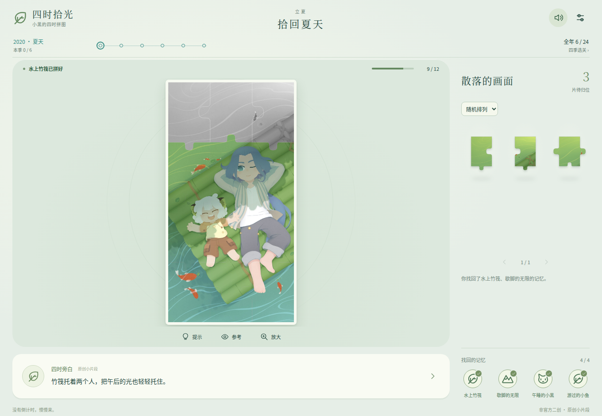 | 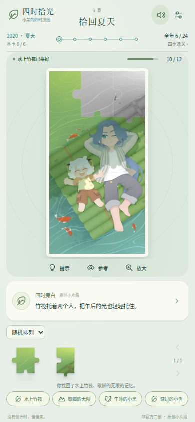 |

### 小满

| 桌面 | 手机 |
|---|---|
| 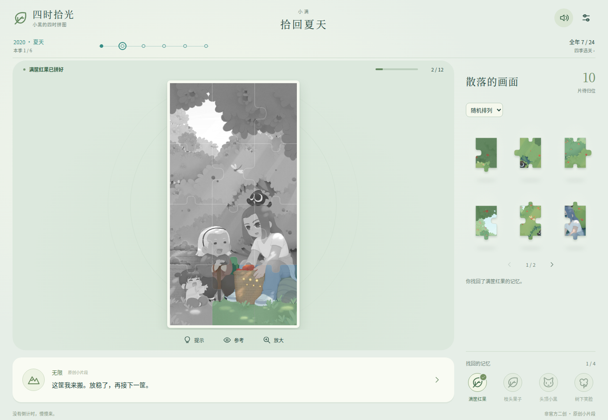 | 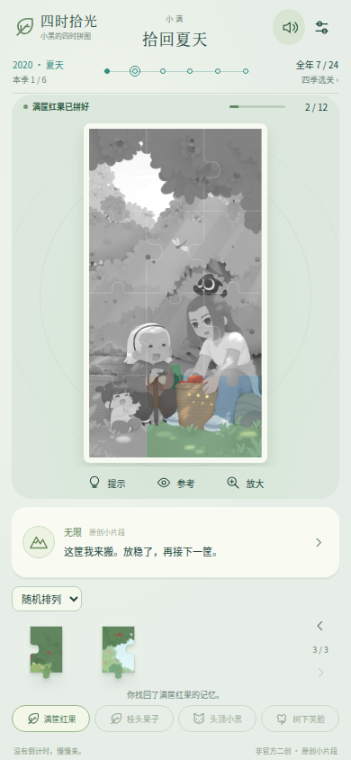 |

### 芒种

| 桌面 | 手机 |
|---|---|
| 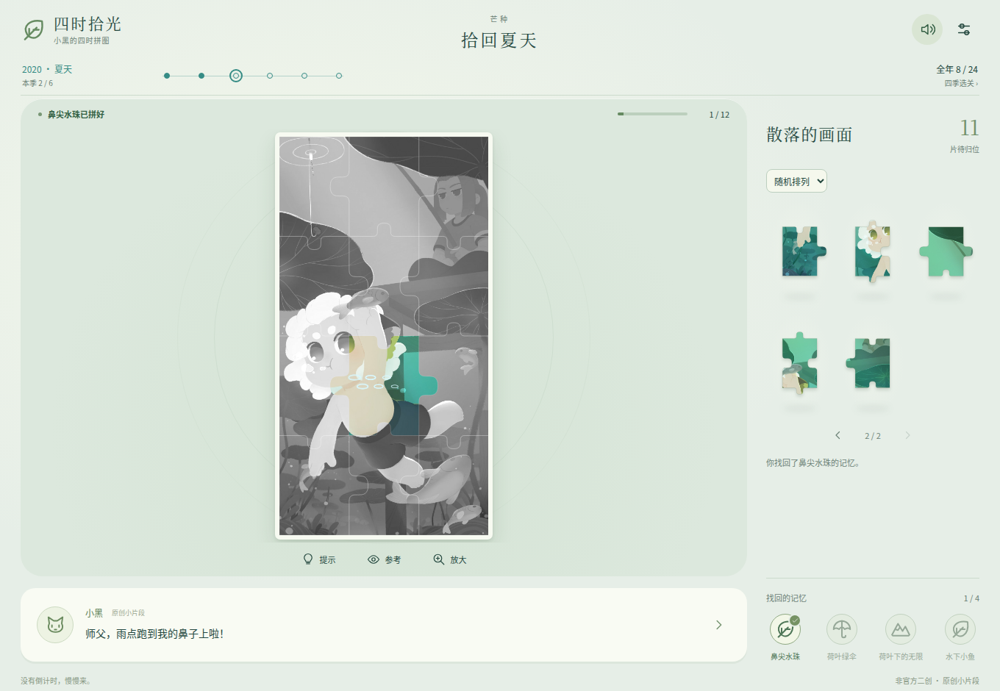 | 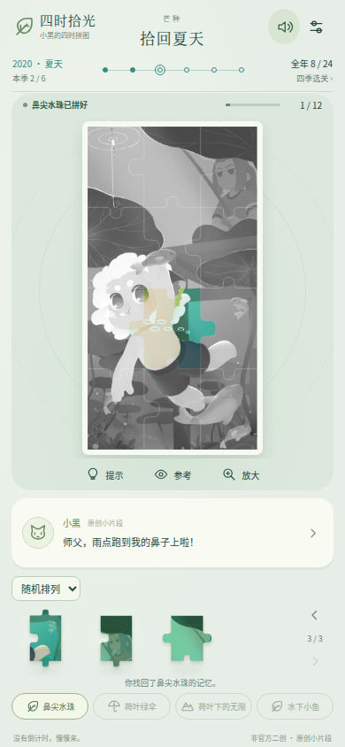 |

### 夏至

| 桌面 | 手机 |
|---|---|
| 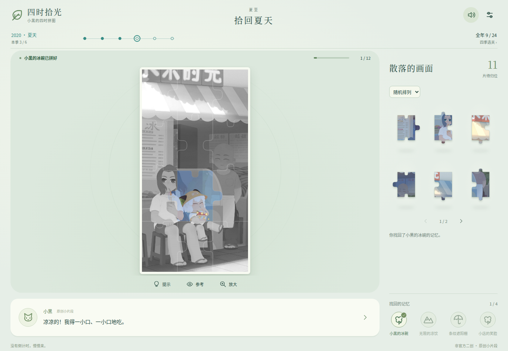 | 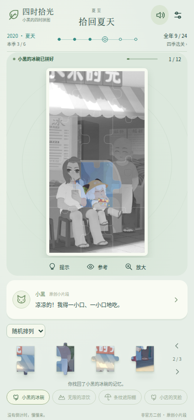 |

### 小暑

| 桌面 | 手机 |
|---|---|
| 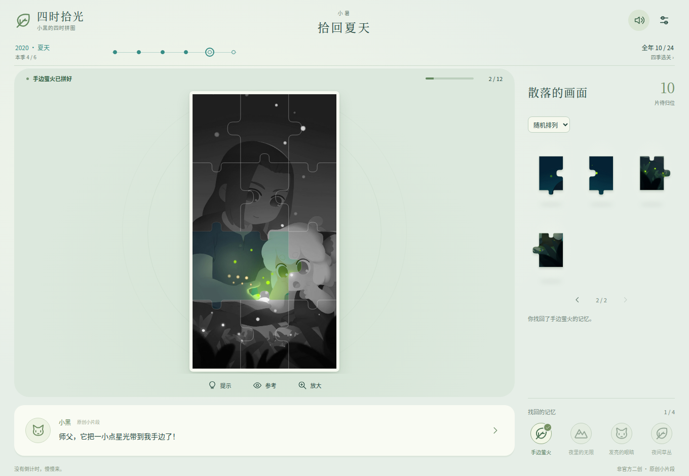 | 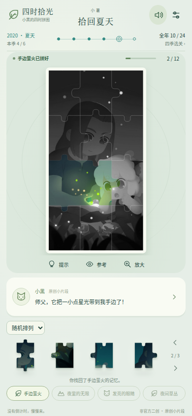 |

### 大暑

| 桌面 | 手机 |
|---|---|
| 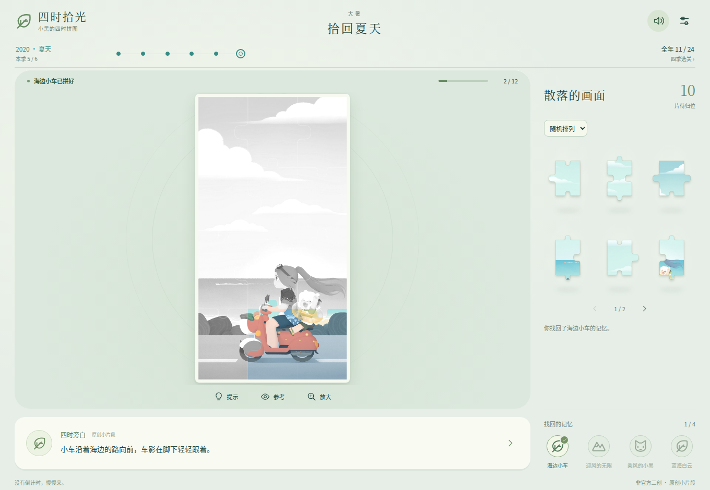 | 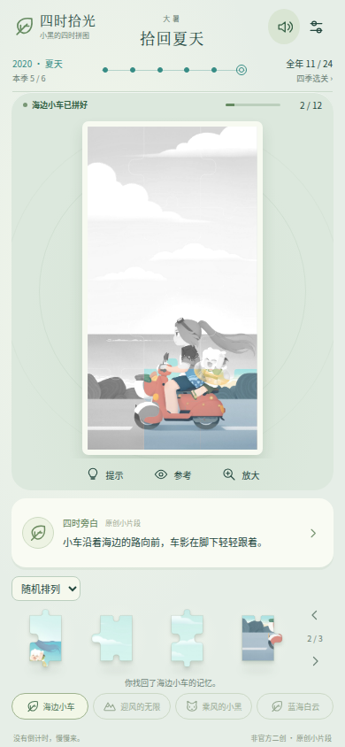 |

### 本季完成

| 桌面 | 手机 |
|---|---|
| 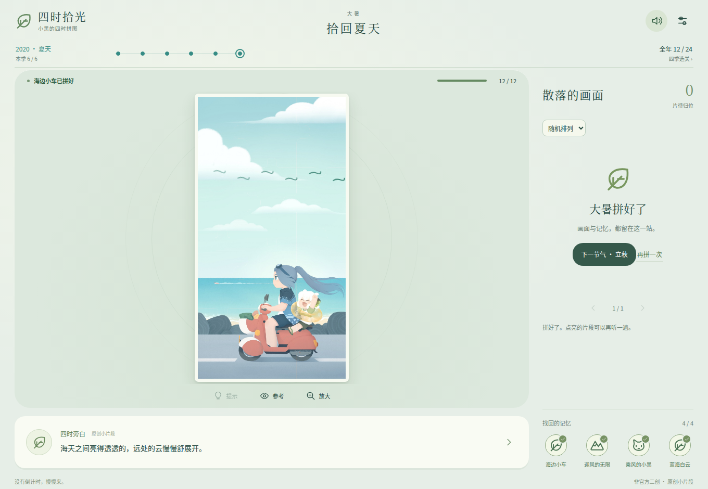 | 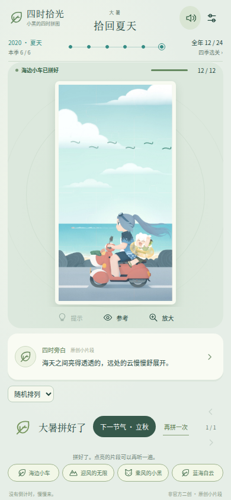 |
