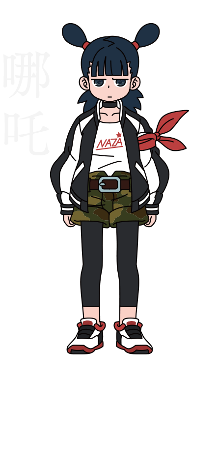
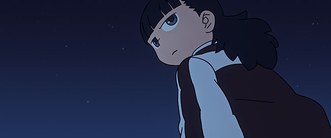
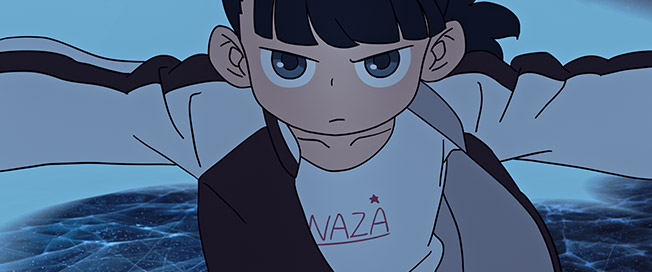
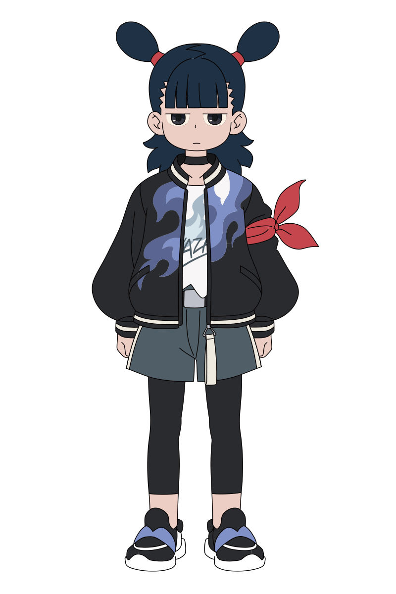
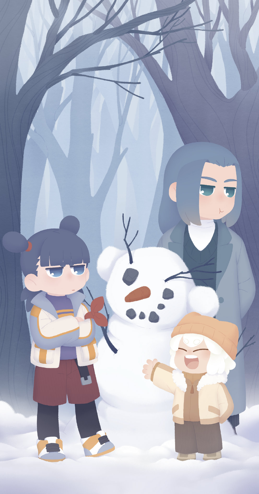

# 哪吒：人物资料与参考图

《罗小黑战记》世界观中的哪吒，来自会馆总部的执行者。双发髻、齐刘海和现代休闲衣装，是辨认他的线索。

入口：`/#/characters/nezha`。核对日期：2026-11-19。背景/关系/性格/能力与造型观察均在页面附来源，2020贺图与不同电影版本分开说明。

## 身份与背景

这是《罗小黑战记》世界观中的哪吒；导演明确说明并非《哪吒之魔童降世》的联动角色。 [来源 1](https://ent.people.com.cn/n1/2019/0911/c1012-31347995.html)

哪吒是妖灵会馆总部派遣的执行者，拥有很强的实力。续作官方资料进一步将他介绍为隶属总馆的妖精、会馆三大创始神之一。 [来源 1](https://luoxiaohei-movie.com/1st/character/?page=chara08) · [来源 2](https://luoxiaohei-movie.com/2nd/character/)

## 性格与相处

发行宣传提到哪吒喜欢游戏。官方立绘中，他多呈平静神情、穿现代休闲装；这些属于外观观察。 [来源 1](https://www.animatetimes.com/news/details.php?id=1763700816) · [来源 2](https://luoxiaohei-movie.com/1st/character/?page=chara08) · [来源 3](https://luoxiaohei-movie.com/2nd/character/)

哪吒与无限同属会馆执行者。续作发行宣传还呈现了无限暂住哪吒家、以及两人对战的情节。 [来源 1](https://luoxiaohei-movie.com/1st/character/?page=chara08) · [来源 2](https://luoxiaohei-movie.com/1st/character/?page=chara02) · [来源 3](https://www.animatetimes.com/news/details.php?id=1763700816)

## 能力与作品阶段

官方续作资料列出御灵系·火、生灵系·幻化、锁御系·灵御。资料页先保留这三项已确认能力，不把别的哪吒作品中的法宝或身世套用过来。 [来源 1](https://luoxiaohei-movie.com/2nd/character/)

## 造型观察

官方角色图可见深色齐刘海、头顶双发髻、低束长发、短款外套与NAZA字样上衣，左上臂系红色饰带；首部电影图与续作图服装图案、短裤和鞋款不同。 [来源 1](https://luoxiaohei-movie.com/1st/character/?page=chara08) · [来源 2](https://luoxiaohei-movie.com/2nd/character/)

## 五张参考图

本支新增图片 236,952 bytes；已有2020图使用原静态资源，不重复保存。每图SHA与实际大小在 `web/src/characters/nezha.json`，构建自动核验。

| 参考 | 观察用途与出处 |
|---|---|
|  | **首部电影·正面全身角色图** 深色双发髻、齐刘海、黑白外套、NAZA上衣、迷彩短裤、七分打底裤与运动鞋；正面放松站姿。 用于首部电影服装分层、身形轮廓、正面配色和饰带位置；不是正交三视图，不提供背面构造。 [原始页面](https://luoxiaohei-movie.com/1st/character/?page=chara08) · [原始图片](https://luoxiaohei-movie.com/1st/assets/img/character/chara_10.png) © 北京寒木春华动画技术有限公司 · 官方发布的原作图像；保留版权；未确认开放再分发、训练或商业使用许可 |
|  | **首部电影·仰视回身画面** 夜色场景，侧后方仰视角色回头，能看见刘海、耳部、后束发与外套后侧轮廓。 用于头部侧后体积和后束发轮廓参考；图像受镜头透视和夜间光照影响，不能量尺寸或当完整背面设定。 [原始页面](https://luoxiaohei-movie.com/1st/character/?page=chara08) · [原始图片](https://luoxiaohei-movie.com/1st/assets/img/character/photo_10-1.jpg) © 北京寒木春华动画技术有限公司 · 官方发布的原作图像；保留版权；未确认开放再分发、训练或商业使用许可 |
|  | **首部电影·张臂近景** 正面偏俯视近景，角色张开双臂，面部轮廓、发际线、外套领口及NAZA字样清楚。 用于面部比例、眼睑、刘海、肩袖与领口结构观察；这是动作帧，不是T-pose或正交图。 [原始页面](https://luoxiaohei-movie.com/1st/character/?page=chara08) · [原始图片](https://luoxiaohei-movie.com/1st/assets/img/character/photo_10-2.jpg) © 北京寒木春华动画技术有限公司 · 官方发布的原作图像；保留版权；未确认开放再分发、训练或商业使用许可 |
|  | **续作电影·正面全身角色图** 双发髻与黑色短外套延续，紫色火焰纹、蓝灰短裤、腰间垂带和鞋款与首部不同。 用于单独记录续作服装版本，方便后续换装建模；不能和首部服装混为同一套设定。 [原始页面](https://luoxiaohei-movie.com/2nd/character/) · [原始图片](https://luoxiaohei-movie.com/2nd/assets/img/chara/chara_04.png) © 北京寒木春华动画技术有限公司 · 官方发布的原作图像；保留版权；未确认开放再分发、训练或商业使用许可 |
|  | **2020大雪·和伙伴堆雪人** 哪吒在画面左侧抱臂，穿冬季浅色外套、紫色内搭、红色短裤；无限在雪人后方，小黑在右下。 用于2020冬装、表情、伙伴相对身高与场景尺度参考；节气插图有风格化变形，不可当精确建模标尺。 [原始页面](https://luoxiaohei.cockerel.com.cn/artwork/huiji:solar/2020/%E5%A4%A7%E9%9B%AA) · [原始图片](https://luoxiaohei.cockerel.com.cn/media/solar/2020/2020-大雪.jpg) © 北京寒木春华动画技术有限公司 · 第三方存档，未逐张核对官方首发；保留版权；未确认开放再分发、训练或商业使用许可 |

## 局限与后续

- 未找到可靠的精确出生年月；超过3000岁来自2025续作人物资料，不推算出生年份。
- 123厘米在社区百科出现，但本轮未找到原始设定来源，页面先不写确定身高。
- 2020大雪官方微博首发帖未逐张核验；保存既有第三方档案来源。
- 没有完整正交三视图或身体背面设定；不能从前面图自行补造背面。
- 所有图片均未确认开放再分发、模型训练或商业建模许可；版权署名不等于授权。

人物、原画与剧照版权归原权利人。此处为非官方参考资料整理；来源公开可读不等于获得转载、训练或商业建模授权。

## 验证

本分支单元测试、模型4项、DOM23项和构建均通过。真实Chrome桌面1360×940、触控模拟390×844/320×568通过：五图原生解码、图册翻页/关闭/焦点返回、角色搜索与状态筛选、直接地址与刷新、未知档案及原拼图和旅程存档保持。外部请求被阻断，未出现外部依赖或页面异常。通用复现命令和检查边界见[人物资料库说明](README.md)。

同步修正大雪“同行的姑娘”为“哪吒”，记忆按钮更名为“哪吒和小黑”，仅替换这一句普通中文旁白。旧音频不再由当前台词清单引用。
