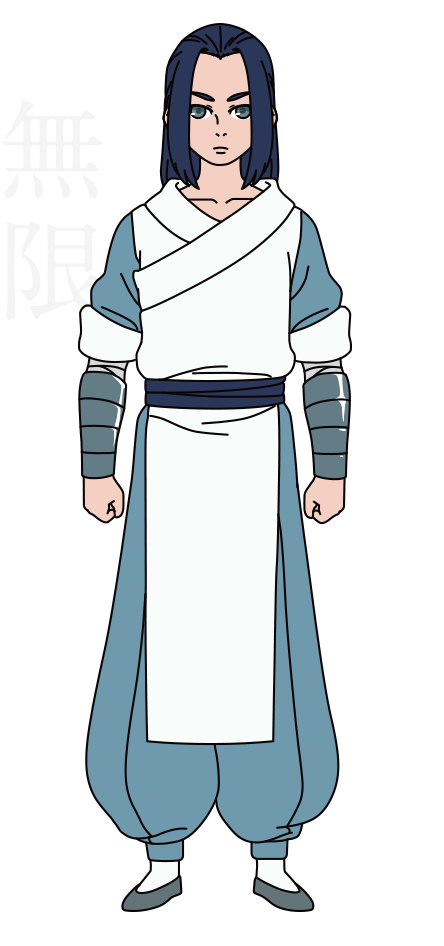
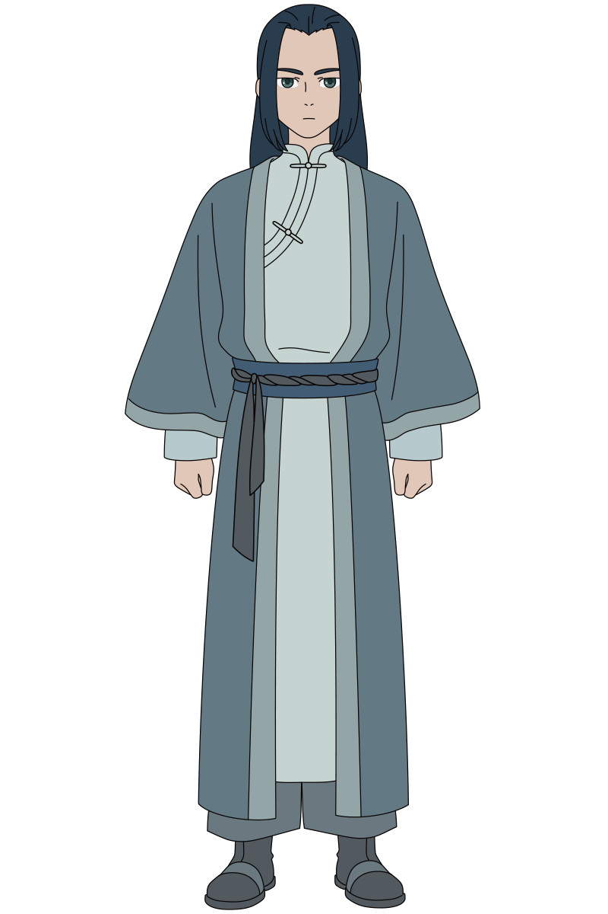
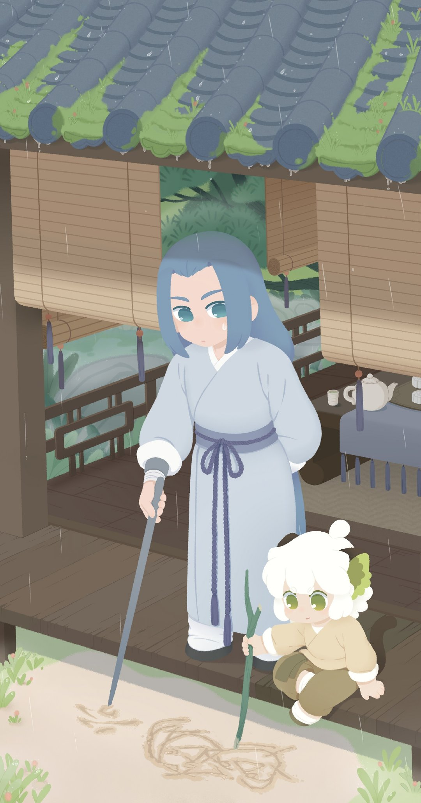

# 无限：人物资料与参考图

人类出身的妖灵会馆执行者，也是小黑的师父。他寡言、少显表情，却并非没有感情。

入口：`/#/characters/wuxian`。核对日期：2026-11-19。背景/关系/性格/能力与造型观察均在页面附来源，2020贺图与不同电影版本分开说明。

## 身份与背景

无限是人类，属于妖精们聚集的会馆，担任执行者。 [来源 1](https://luoxiaohei-movie.com/character/?page=chara02) · [来源 2](https://luoxiaohei-movie.com/2nd/character/)

首部电影官方人物页将无限称为“最强的执行者”。 [来源 1](https://luoxiaohei-movie.com/character/?page=chara02) · [来源 2](https://luoxiaohei-movie.com/2nd/character/)

无限是小黑的师父；电影第二部官方简介使用师父称呼，二人有共同生活和旅行的经历。 [来源 1](https://luoxiaohei-movie.com/2nd/)

## 性格与相处

无限通常寡言、少有表情变化，但并不是没有感情。 [来源 1](https://luoxiaohei-movie.com/character/?page=chara02) · [来源 2](https://luoxiaohei-movie.com/2nd/character/)

## 能力与作品阶段

无限具有御灵系·金与空间系能力。 [来源 1](https://luoxiaohei-movie.com/character/?page=chara02) · [来源 2](https://luoxiaohei-movie.com/2nd/character/)

电影第二部资料进一步介绍其空间系·己界（吞噬），能将周围物体收入自己的灵域。 [来源 1](https://luoxiaohei-movie.com/2nd/character/)

电影第二部资料中，鹿野是无限最后收下的弟子，也是小黑的师姐。 [来源 1](https://luoxiaohei-movie.com/2nd/character/)

## 造型观察

两版电影官方正面立绘都可观察到深蓝至蓝灰色的齐肩发、绿色眼睛和清晰的中分发际；电影第一部为交领上衣、护腕和束脚裤，第二部为较长袍服。此处是图像观察，不是精确色值或三视图设定。 [来源 1](https://luoxiaohei-movie.com/character/?page=chara02) · [来源 2](https://luoxiaohei-movie.com/2nd/character/)

## 五张参考图

本支新增图片 206,370 bytes；已有2020图使用原静态资源，不重复保存。每图SHA与实际大小在 `web/src/characters/wuxian.json`，构建自动核验。

| 参考 | 观察用途与出处 |
|---|---|
|  | **电影第一部·无限正面立绘** 正面全身、交领上衣、深蓝护腕、束脚裤。图片左侧含日文角色名，保留原图不得伪称无字三视图。 观察头身比例、发际、眼形、衣领交叠、护腕及裤脚轮廓。 [原始页面](https://luoxiaohei-movie.com/character/?page=chara02) · [原始图片](https://luoxiaohei-movie.com/assets/img/character/chara_02.png) © 北京寒木春华动画技术有限公司 · 官方发布的原作图像；保留版权；未确认开放再分发、训练或商业使用许可 |
|  | **电影第二部·无限长袍正面立绘** 正面全身长袍造型，与第一部衣装不同；不可混成同一套服装。 补充长袍外轮廓、袖宽、腰带层次、垂坠及鞋型；建立独立服装变体。 [原始页面](https://luoxiaohei-movie.com/2nd/character/) · [原始图片](https://luoxiaohei-movie.com/2nd/assets/img/chara/chara_02.png) © 北京寒木春华动画技术有限公司 · 官方发布的原作图像；保留版权；未确认开放再分发、训练或商业使用许可 |
|  | **2020谷雨·廊下习字** 微俯视、三分之二正面、浅色长袍，手握长杆在地面上写画，小黑坐在旁边。 用于长袍体块、束带、袖口、握持姿势以及师徒比例比较；不能当成官方正交侧视。 [原始页面](https://luoxiaohei.huijiwiki.com/wiki/%E6%96%87%E4%BB%B6:2020%E5%B9%B4%E8%B0%B7%E9%9B%A8%E8%B4%BA%E5%9B%BE.jpg) · [原始图片](https://luoxiaohei.cockerel.com.cn/media/solar/2020/2020-谷雨.jpg) © 北京寒木春华动画技术有限公司 · 第三方存档，未逐张核对官方首发；保留版权；未确认开放再分发、训练或商业使用许可 |
|  | **2020大雪·与小黑、哪吒堆雪人** 冬装、略侧正面站姿；哪吒在画面左侧，无限在右后方，小黑在右前方。 冬装叠穿厚度、外套领形、发型被衣领遮挡的情况，以及三个人物的体量对照。 [原始页面](https://luoxiaohei.huijiwiki.com/wiki/%E6%96%87%E4%BB%B6:2020%E5%B9%B4%E5%A4%A7%E9%9B%AA%E8%B4%BA%E5%9B%BE.jpg) · [原始图片](https://luoxiaohei.cockerel.com.cn/media/solar/2020/2020-大雪.jpg) © 北京寒木春华动画技术有限公司 · 第三方存档，未逐张核对官方首发；保留版权；未确认开放再分发、训练或商业使用许可 |
|  | **2020立夏·竹筏上歇息** 俯视、仰卧姿势、两手置于脑后、敞开条纹外衫、短裤和赤脚，小黑在旁入睡。 观察躯干和四肢放松时的比例、衣袖褶皱与手脚姿势；透视较强，不能直接量取骨骼尺寸。 [原始页面](https://luoxiaohei.huijiwiki.com/wiki/%E6%96%87%E4%BB%B6:2020%E5%B9%B4%E7%AB%8B%E5%A4%8F%E8%B4%BA%E5%9B%BE.jpg) · [原始图片](https://luoxiaohei.cockerel.com.cn/media/solar/2020/2020-立夏.jpg) © 北京寒木春华动画技术有限公司 · 第三方存档，未逐张核对官方首发；保留版权；未确认开放再分发、训练或商业使用许可 |

## 局限与后续

- 不在核心卡片写生日、年龄和身高：本轮未取得同一时间线下完整一致的原始设定。电影第二部官方年龄439岁不能移植到2020节气贺图。
- 2020节气图属于贺图语境，不能直接认定发生在2019电影、2025电影第二部或TV某一集的特定时间点。
- 没有核实无限与哪吒的亲缘关系，也没有依据将二人写作师徒；本轮只确认共同属于会馆语境并在大雪画面同场。
- 官方页面的立绘并未提供背面或完整侧面；现有5张参考不构成建模所需的官方三视图。
- 第三方收藏的原始作者/权利人标注不等于官方首发帖核验，更不等于获得转载、建模、训练或商业使用许可。

人物、原画与剧照版权归原权利人。此处为非官方参考资料整理；来源公开可读不等于获得转载、训练或商业建模授权。

## 验证

本分支单元测试、模型4项、DOM23项和构建均通过。真实Chrome桌面1360×940、触控模拟390×844/320×568通过：五图原生解码、图册翻页/关闭/焦点返回、角色搜索与状态筛选、直接地址与刷新、未知档案及原拼图和旅程存档保持。外部请求被阻断，未出现外部依赖或页面异常。通用复现命令和检查边界见[人物资料库说明](README.md)。
