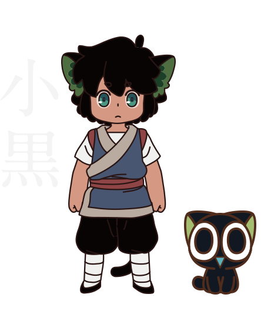
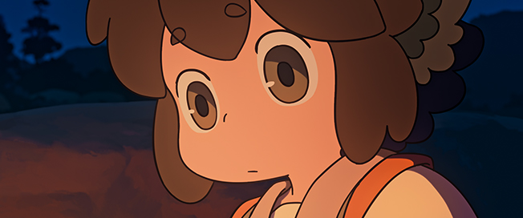
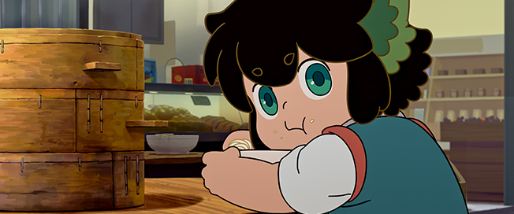
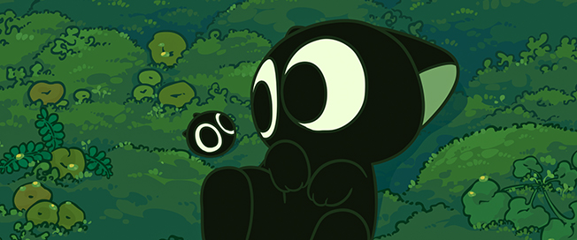
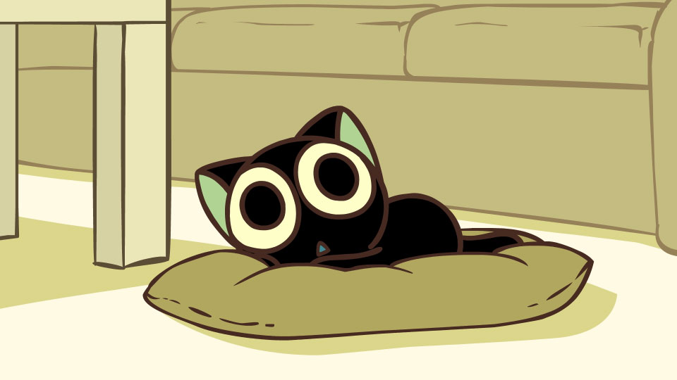

# 罗小黑：人物资料与参考图

能在人形与猫形之间变化的黑猫妖精。跟着无限学习，也在与小白相伴的日子里认识人类世界。

入口：`/#/characters/xiaohei`。核对日期：2026-11-19。背景/关系/性格/能力与造型观察均在页面附来源，2020贺图与不同电影版本分开说明。

## 身份与背景

小黑是一只黑猫妖精，也是男孩子；可以变成人形。 [来源 1](https://luoxiaohei-movie.com/2nd/character/) · [来源 2](https://bgm.tv/character/26123)

## 性格与相处

直率、活泼，对世界保有好奇，也喜欢人类的食物。 [来源 1](https://luoxiaohei-movie.com/1st/character/) · [来源 2](https://luoxiaohei-movie.com/2nd/character/)

无限是小黑的师父，带着他学习和生活。 [来源 1](https://luoxiaohei-movie.com/tv/character/) · [来源 2](https://luoxiaohei-movie.com/2nd/)

小白在小黑受伤流落街头时救助他，之后与他一起生活。 [来源 1](https://luoxiaohei-movie.com/tv/character/) · [来源 2](https://www.aniplex.co.jp/lineup/luoxiaohei-tv/)

## 能力与作品阶段

有御灵系·金与空间系·传送能力，能操纵金属、连接空间。其领域能力随剧情阶段变化，不能把所有时期能力直接叠加。 [来源 1](https://luoxiaohei-movie.com/2nd/character/) · [来源 2](https://luoxiaohei-movie.com/1st/character/) · [来源 3](https://luoxiaohei.huijiwiki.com/wiki/罗小黑)

尾巴能分裂成称为黑咻的小生物。黑咻与小黑是不同的资料条目。 [来源 1](https://luoxiaohei-movie.com/2nd/character/) · [来源 2](https://luoxiaohei-movie.com/tv/character/)

## 造型观察

建模参考需区分猫形、人形以及不同作品的衣着和发色。2019电影官图是交领上衣、七分裤；电影2官图为现代便装；形象标注以对应图为准。 [来源 1](https://luoxiaohei-movie.com/1st/character/) · [来源 2](https://luoxiaohei-movie.com/2nd/character/)

## 五张参考图

本支新增图片 484,602 bytes；已有2020图使用原静态资源，不重复保存。每图SHA与实际大小在 `web/src/characters/xiaohei.json`，构建自动核验。

| 参考 | 观察用途与出处 |
|---|---|
|  | **人形与猫形正面全身** 同一张立绘同时包含人形与黑猫形态。 核对猫耳、绿色内耳、头身比、交领上衣、绑腿与猫形基础比例。 [原始页面](https://luoxiaohei-movie.com/1st/character/) · [原始图片](https://luoxiaohei-movie.com/1st/assets/img/character/chara_01.png) © 北京寒木春华动画技术有限公司 · 官方发布的原作图像；保留版权；未确认开放再分发、训练或商业使用许可 |
|  | **人形斜侧脸·夜间暖光** 暖色夜景中的斜侧脸近景，手在颈前。 观察脸颊轮廓、鼻口极简结构、耳朵和发束层次；暖光不能当作固有色。 [原始页面](https://luoxiaohei-movie.com/1st/character/) · [原始图片](https://luoxiaohei-movie.com/1st/assets/img/character/photo_01-1.jpg) © 北京寒木春华动画技术有限公司 · 官方发布的原作图像；保留版权；未确认开放再分发、训练或商业使用许可 |
|  | **人形背侧·餐桌动作** 从背侧看坐姿进食，能见上衣背面、袖口、脸颊和手。 补充背侧衣片、袖子与手臂在动作中的关系，不能替代完整背面三视图。 [原始页面](https://luoxiaohei-movie.com/1st/character/) · [原始图片](https://luoxiaohei-movie.com/1st/assets/img/character/photo_01-2.jpg) © 北京寒木春华动画技术有限公司 · 官方发布的原作图像；保留版权；未确认开放再分发、训练或商业使用许可 |
|  | **猫形四分之三侧面与黑咻** 坐着的黑猫形小黑，旁有体积更小的黑咻。 核对大眼、尖耳、四肢与躯干体积，区分猫形小黑和黑咻。 [原始页面](https://luoxiaohei-movie.com/1st/character/) · [原始图片](https://luoxiaohei-movie.com/1st/assets/img/character/photo_01-3.jpg) © 北京寒木春华动画技术有限公司 · 官方发布的原作图像；保留版权；未确认开放再分发、训练或商业使用许可 |
|  | **猫形趴卧与尾巴** 趴在垫子上的小黑，全身与尾巴可见。 观察猫形趴卧时的躯干轮廓、眼脸比例、尾巴走势。 [原始页面](https://luoxiaohei-movie.com/tv/character/) · [原始图片](https://luoxiaohei-movie.com/tv/assets/img/chara_01.jpg) © 北京寒木春华动画技术有限公司 · 官方发布的原作图像；保留版权；未确认开放再分发、训练或商业使用许可 |

## 局限与后续

- 不在通用简介填写统一年龄：官方电影1写6岁、电影2写8岁，TV时间线不同；如以后显示年龄必须带作品阶段。
- 生日没有获得本轮已读官方文字确认，先不填。
- 五张公开参考并非完整三视图，没有严格正交背面，建模前仍需补正式设定集与授权。
- 官方发布图仍属于原权利人，公开可读不等于获得建模训练或商业授权。

人物、原画与剧照版权归原权利人。此处为非官方参考资料整理；来源公开可读不等于获得转载、训练或商业建模授权。

## 验证

本分支单元测试、模型4项、DOM23项和构建均通过。真实Chrome桌面1360×940、触控模拟390×844/320×568通过：五图原生解码、图册翻页/关闭/焦点返回、角色搜索与状态筛选、直接地址与刷新、未知档案及原拼图和旅程存档保持。外部请求被阻断，未出现外部依赖或页面异常。通用复现命令和检查边界见[人物资料库说明](README.md)。
